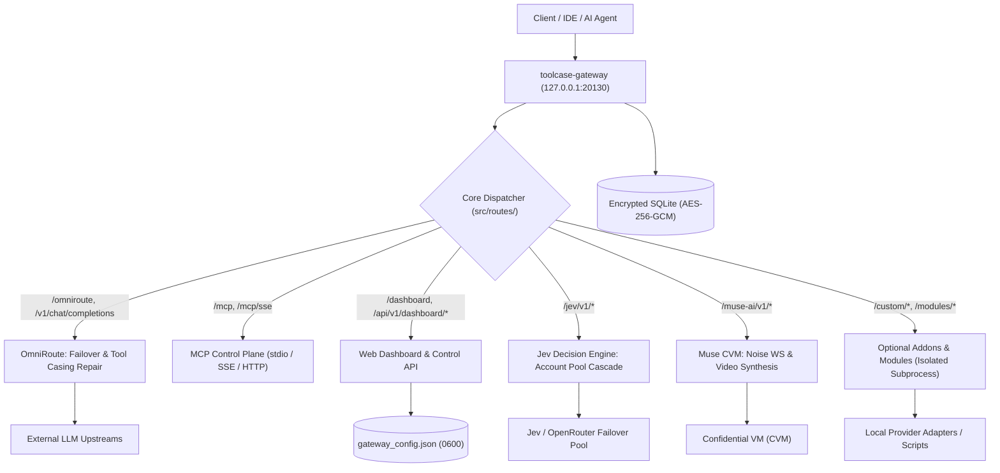

# Toolcase Gateway (`toolcase-gateway`)

[](https://www.rust-lang.org)
[](LICENSE)
[](docs/SYSTEM_DESIGN.md)
[](docs/ARCHITECTURE.md)

**A high-performance, zero-async Rust AI and tool gateway running as a local sidecar between agent runners, developer IDEs, SDKs, and upstream AI engines.**

Toolcase Gateway sits transparently on loopback (`127.0.0.1:20130`), unifying multi-provider AI routing, automatic tool normalization, model failover cascades, decision evaluation, and native Model Context Protocol (MCP) coordination into a single lightweight binary (< 400 KB) with zero heavy runtime overhead.

---

## Highlights of Toolcase Gateway

### 1. Transparent Tool-Name Casing Drift Repair
Upstream LLMs and proxies frequently alter function or tool names during completion generation (e.g., lowercasing `SearchCodebase` → `searchcodebase`), breaking strict tool-calling clients and IDE extensions. Toolcase Gateway inspects original client tool definitions and transparently restores original tool casings in streaming chunks on the fly.

### 2. Multi-Candidate Model Failover Cascade
When an upstream provider hits rate limits (`429`), temporary outages (`503`), or context window limits, the gateway intercepts the failure **before** committing bytes to downstream clients. It automatically retries through configured fallback models and account pools seamlessly, ensuring uninterrupted agent execution.

### 3. Native Model Context Protocol (MCP) Control Plane
First-class support for the Model Context Protocol across all three official transport standards:
- **`stdio`**: Local IDE execution (`toolcase-gateway --mcp`) for Claude Desktop, Cursor, Windsurf, and Antigravity.
- **`SSE`**: HTTP Server-Sent Events (`GET /mcp/sse`) for real-time remote agent streaming.
- **`Streamable HTTP`**: Modern bidirectional JSON-RPC 2.0 exchange (`POST /mcp`).

Agents can query system metrics, inspect active routes, test connectivity, and orchestrate tools through standard MCP primitives.

### 4. Zero-Async Native Rust Architecture
Engineered strictly with standard library blocking networking (`std::net`, `std::thread`, and crossbeam channels) without `tokio`, `async-std`, or complex futures runtimes:
- Fast cold starts (< 5 ms).
- Predictable deterministic latency and minimal memory footprint (< 15 MB RSS).
- Compile-time guaranteed memory safety with `#![forbid(unsafe_code)]`.

### 5. Multi-Provider AI Subsystems
- **Prism & OpenAI-Compatible Gateways** (`/omniroute`, `/v1/chat/completions`): Transparent token handling, multi-account rotation, and reasoning effort parameter injection.
- **Jev AI Decision Engine** (`/jev/v1/systemone`, `/jev/v1/decisions`): Structured decision scoring and classification with account pooling, round-robin rotation, and credit-limit cooldown windows.
- **Muse AI Confidential VM Subsystem** (`/muse-ai/v1/*`): Encrypted Noise XX WebSocket sessions to confidential VMs, conversational multi-turn chat continuity, image synthesis, and text-to-video pipelines with Sentinel auto-approvals.

### 6. Interactive Web Dashboard & Hot Reconfiguration
Embedded web control center at `http://127.0.0.1:20130/dashboard`:
- Live routing inspector, fallback configuration, and latency/uptime metrics.
- Hot credential and pool updates without restarting the gateway process.
- Atomic POSIX `0600` standalone persistence to `gateway_config.json`, keeping repository `.env` untouched.

### 7. Fail-Closed Security & Encrypted Storage
- Loopback-only binding (`127.0.0.1`) by default; flags unauthorized network exposure.
- Header injection prevention (rejects `CR`, `LF`, `NUL`) and HTTP request smuggling defense.
- Passwords, cookies, and bearer tokens masked across all logs, status responses, and UI endpoints.
- Embedded SQLite with AES-256-GCM envelope encryption and blind indexing for local credential storage.

### 8. Extensible Module & Addon Feature
For users needing custom providers or specialized external workflows, the gateway provides an optional **modular plugin system**:
- Author or drop custom adapters into `./addons/<id>/` or `$GW_STATE_DIR/modules/<id>/`.
- Isolated out-of-process execution (`stdio-stream` child process or loopback HTTP) preventing module crashes from impacting the core gateway.
- Dedicated URL prefix routing (e.g. `/custom/my-adapter/*`).

---

## Architecture



---

## Installation

### Prerequisites
- Rust 1.74+ (`cargo` and `rustc`)

### Build from Source
```bash
git clone https://github.com/giauphan/toolcase-gateway.git
cd toolcase-gateway
cargo build --release
```

The compiled binary will be placed at `target/release/toolcase-gateway` (~350 KB, stripped, LTO).

---

## Quick Start

### 1. Launch the Gateway
```bash
# Run with default settings (listens on 127.0.0.1:20130, proxies to 127.0.0.1:20128)
./target/release/toolcase-gateway
```

### 2. Configure Custom Target & Fallbacks
```bash
GW_TARGET_HOST=127.0.0.1 \
GW_TARGET_PORT=8080 \
GW_FALLBACK_MODELS="gpt-4o-mini,claude-3-5-sonnet" \
./target/release/toolcase-gateway
```

### 3. Open the Web Dashboard
Navigate to `http://127.0.0.1:20130/dashboard` in any browser to inspect active routes, manage credentials, or view live traffic metrics.

---

## Model Context Protocol (MCP) Usage

To connect an AI assistant or IDE to the gateway via MCP:

### Stdio Mode (Claude Desktop, Cursor, Windsurf)
Add the following to your MCP client configuration file:
```json
{
  "mcpServers": {
    "toolcase-gateway": {
      "command": "/path/to/toolcase-gateway",
      "args": ["--mcp"]
    }
  }
}
```

### SSE / Remote HTTP Mode
Point your agent runner to:
- SSE Endpoint: `http://127.0.0.1:20130/mcp/sse`
- HTTP JSON-RPC Endpoint: `http://127.0.0.1:20130/mcp`

---

## Core Configuration Reference

The gateway supports dual-layer configuration: initial startup via environment variables (or `.env`), and runtime persistence via `gateway_config.json` editable via the dashboard.

| Variable | Default | Description |
| :--- | :--- | :--- |
| `GW_LISTEN_HOST` | `127.0.0.1` | Loopback bind address. Non-loopback IPs trigger security warnings. |
| `GW_LISTEN_PORT` | `20130` | Gateway HTTP listen port. |
| `GW_TARGET_HOST` | `127.0.0.1` | Default upstream LLM host. |
| `GW_TARGET_PORT` | `20128` | Default upstream LLM port. |
| `GW_FALLBACK_MODELS` | `fail-try` | Comma-separated list of fallback models for automatic failover. |
| `GW_MAX_CONNECTIONS` | `256` | Maximum concurrent connection limit; excess rejected with `503`. |
| `GW_IO_TIMEOUT_SECS` | `120` | Read and write socket timeout in seconds (`0` disables). |
| `GW_JEV_API_KEYS` | empty | Comma-separated Jev AI account keys for decision failover pool. |
| `GW_JEV_OPENROUTER_API_KEY` | empty | OpenRouter API key for decision evaluations. |
| `GW_MUSE_APPROVAL_MODE` | `off` | Sentinel auto-approval mode (`off`, `observe`, `on`). |

See [`docs/CONFIGURATION.md`](docs/CONFIGURATION.md) for full configuration details and advanced tuning options.

---

## Extensible Modules & Addons (Optional Feature)

Modules are an optional feature for developers who want to extend Toolcase Gateway with bespoke external tools, proprietary models, or specialized provider adapters:

- **Isolated Execution**: Adapters run out-of-process using `stdio-stream` (newline-delimited JSON-RPC) or loopback HTTP.
- **Dedicated Namespace**: Each module claims an isolated prefix such as `/custom/<module-id>/*`.
- **Auto-Discovery**: Modules dropped into `./addons/<module-id>/` containing a `module.json` manifest are automatically registered on gateway boot.

A starter reference template is included in [`addons/echo-provider/`](addons/echo-provider/). For complete instructions on authoring or installing addons, see [`docs/MODULES.md`](docs/MODULES.md) and [`addons/README.md`](addons/README.md).

---

## Security Invariants

- **Loopback Enforcement**: Designed strictly to run locally adjacent to clients.
- **Zero Secret Commits**: Passwords, API tokens, and cookies are masked in logs and API output.
- **Memory & Process Safety**: Subprocess environments are sanitized; gateway master keys are never passed down.
- **Request Hygiene**: Strict HTTP parsing rejects ambiguous framing and CRLF header injections immediately.

For full architectural threat modeling, consult [`docs/SECURITY_MODEL.md`](docs/SECURITY_MODEL.md).

---

## Development & Verification

```bash
cargo test                    # Run comprehensive unit and integration test suite
cargo clippy --all-targets    # Run static analysis and lint checks
cargo fmt -- --check          # Check code formatting compliance
cargo build --release         # Build optimized production binary
```

---

## Documentation Directory

- [`docs/ARCHITECTURE.md`](docs/ARCHITECTURE.md) — Architectural overview, canonical routes, and system lifecycle
- [`docs/SYSTEM_DESIGN.md`](docs/SYSTEM_DESIGN.md) — Core subsystems, zero-async mechanics, and file size governance
- [`docs/PROJECT_STRUCTURE.md`](docs/PROJECT_STRUCTURE.md) — Live source code directory tree and Clean Architecture layers
- [`docs/CONFIGURATION.md`](docs/CONFIGURATION.md) — Dual-layer configuration reference and JSON schema
- [`docs/SECURITY_MODEL.md`](docs/SECURITY_MODEL.md) — Threat modeling, credential masking, and POSIX permissions
- [`docs/JEV_INTEGRATION.md`](docs/JEV_INTEGRATION.md) — Jev Decision API schemas and pool rotation mechanics
- [`docs/MODULES.md`](docs/MODULES.md) — Modular addon plugin guide, manifest schema, and auto-discovery

---

## License

MIT License — see [`LICENSE`](LICENSE).
