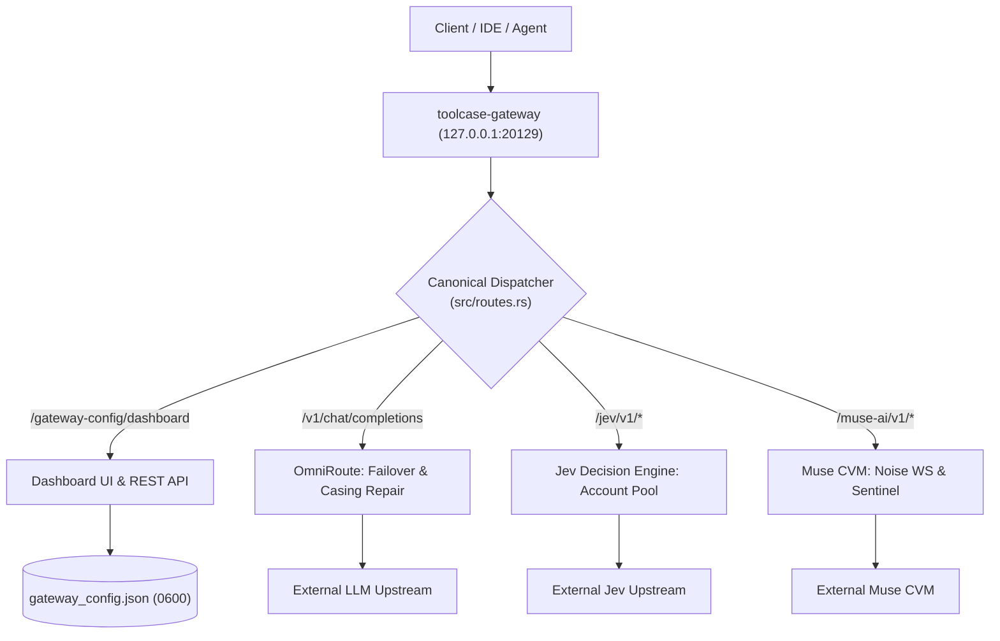

# toolcase-gateway

**A zero-async Rust reverse proxy and multi-provider sidecar for OpenAI-compatible LLMs, Jev AI Decision APIs, and Muse AI Confidential VMs.**

`toolcase-gateway` sits between clients (agent runners, editor extensions, CLIs, SDKs) and diverse upstream AI engines. It solves everyday operational challenges across hosted providers:

1. **Tool-Name Casing Drift** — Upstreams frequently lowercase function/tool names (`MyTool` → `mytool`), breaking strict clients. The gateway restores original casing from the request on the fly.
2. **Model Candidate Failover** — When an upstream model returns `429`, `503`, or credit/auth errors, the gateway retries transparently against configured fallback models before returning anything to the client.
3. **Prism OpenAI Adaptation** — Transparently acts as an OpenAI `/v1/chat/completions` endpoint backed by Prism (including transparent `reasoning_effort` and token injection).
4. **Jev AI Decision API & OpenRouter Failover Pool** — Routes structured decision evaluations (`/jev/v1/systemone`, `/jev/v1/decisions`) and executes a structured 4-tier failover cascade (`Direct Jev -> Jev OpenRouter API Key -> OpenRouter Different Decision -> OpenRouter Browser Cookie`) with round-robin rotation and automatic cooldown demotion on credit caps (`401, 402, 403, 429`).
5. **Muse AI CVM & Video Generation** — Connects directly to Muse Confidential VMs via Noise XX encrypted WebSockets, supports text-to-video synthesis (`/muse-ai/v1/create-video`), and provides headless Sentinel auto-approvals.
6. **Interactive Dashboard & Standalone Persistent Storage** — Embedded web management UI at `/gateway-config/dashboard` that saves settings and provider keys to `gateway_config.json` via atomic POSIX `0600` file replacement, leaving `.env` untouched.

Zero heavy async runtimes (`tokio` forbidden; standard library blocking networking only) and `#![forbid(unsafe_code)]`.

---

## Table of contents

- [How it works](#how-it-works)
- [Install](#install)
- [Quick start](#quick-start)
- [Web Dashboard](#web-dashboard)
- [Provider Integrations](#provider-integrations)
  - [Prism OpenAI](#prism-openai)
  - [Jev AI Decision API](#jev-ai-decision-api)
  - [Muse AI Subsystem](#muse-ai-subsystem)
- [Configuration](#configuration)
- [Security Model](#security-model)
- [Documentation](#documentation)
- [Development](#development)
- [License](#license)

---

## How it works



The failover decision happens **before** any byte reaches the client, ensuring retries are completely invisible downstream. Once committed, response streams are processed chunk-by-chunk with casing restored on the fly.

---

## Install

Requires Rust 1.74+.

```sh
git clone https://github.com/giauphan/toolcase-gateway.git
cd toolcase-gateway
cargo build --release
```

The binary lands at `target/release/toolcase-gateway` (~350 KB, stripped, LTO).

---

## Quick start

```sh
# Start gateway on default port 127.0.0.1:20129 proxying to 127.0.0.1:20128
./target/release/toolcase-gateway
```

```sh
# Start with custom upstream and fallback chain
GW_TARGET_HOST=127.0.0.1 \
GW_TARGET_PORT=8080 \
GW_FALLBACK_MODELS="gpt-4o-mini,claude-3-5-sonnet" \
./target/release/toolcase-gateway
```

Point your client at `http://127.0.0.1:20129` instead of the direct upstream address.

---

## Web Dashboard

The gateway includes an embedded, real-time web dashboard accessible at:

```
http://127.0.0.1:20129/gateway-config/dashboard
```

From the dashboard, operators can:
- Inspect active upstream targets, fallback models, and masked credentials.
- Add provider API keys (e.g., Jev AI account keys) to active rotation pools.
- Update target host, port, timeout, and default models without restarting.
- Configure Muse credentials, VM IDs, default video prompt, and headless Sentinel auto-approval policies.
- Automatically save all changes to `gateway_config.json` with POSIX `0600` permissions.

---

## Provider Integrations

### Prism OpenAI

You can pass multiple Prism accounts per request by providing credentials in `Authorization: Bearer <API_KEY>` or `x-api-key`:

```text
<GW_PRISM_COOKIE>|||<OPENAI_SENTINEL_TOKEN>|||<GW_PRISM_SANDBOX_TOKEN>|||<GW_PRISM_USER_ID>|||<GW_PRISM_PROJECT_ID>
```

The gateway extracts `OPENAI_SENTINEL_TOKEN` and forwards it as Prism's `openai-sentinel-token` request header.

### Jev AI Decision API & OpenRouter Failover

Dedicated routes (`/jev/v1/systemone`, `/jev/v1/decisions`, `/jev/v1/models`, `/jev/v1/requests/{id}`) pool direct Jev accounts, OpenRouter Bearer API keys, and browser session cookies, executing a 4-tier failover cascade:

$$\text{Direct Jev} \longrightarrow \text{Jev OpenRouter (API Key)} \longrightarrow \text{OpenRouter Different Decision} \longrightarrow \text{OpenRouter Browser (Cookie)}$$

When an account encounters credit limits (`402 Payment Required`) or rate limits (`429`), it enters a configurable cooldown window (`GW_JEV_CREDIT_COOLDOWN_SECS`, default 300s). Subsequent requests ("after") immediately continue round-robin rotation across remaining healthy accounts.

Configure credentials via the dashboard UI or environment variables:
```sh
# Direct Jev AI account pool
GW_JEV_API_KEYS="key-1,key-2,key-3"

# OpenRouter Decision API integration
GW_JEV_OPENROUTER_API_KEY="sk-or-v1-..."
GW_JEV_OPENROUTER_COOKIE="or_statsig_stable_id=...; __session=..."
GW_JEV_OPENROUTER_MODEL="typesafe/jev-1.13"
GW_JEV_OPENROUTER_FALLBACK_MODELS="baseten/mammoth-1:free,nace-ai/drex-max"
```

Submit decision requests (evaluating multiple concurrent questions via the **Parallel Sampler**):
```sh
curl -X POST "http://127.0.0.1:20129/jev/v1/systemone" \
  -H "Content-Type: application/json" \
  -H "Idempotency-Key: ticket-8814-20261010" \
  -d '{
    "model": "jev-1.13",
    "state": {
      "task": "Customer requesting a refund due to duplicate charges",
      "customer_tier": "VIP"
    },
    "questions": {
      "category": {
        "type": "choice",
        "instructions": "Identify the primary topic of the request.",
        "criteria": {
          "billing": "Charges, invoices, refunds, pricing, or fees.",
          "technical": "A product feature is broken or failing."
        }
      },
      "urgency": {
        "type": "score",
        "instructions": "Score urgency from 0 to 3 based on impact.",
        "criteria": [
          "0: Informational inquiry; no disruption.",
          "1: Minor issue, core features work.",
          "2: Blocks core workflow or financial hold-up.",
          "3: Critical stoppage or active loss."
        ]
      }
    }
  }'
```

See [`docs/JEV_INTEGRATION.md`](docs/JEV_INTEGRATION.md) for full schemas and setup guides.

### Muse AI Subsystem

Directly communicates with Muse Confidential VMs (CVM) using Noise XX protocol WebSockets. Supports text-to-video synthesis at `/muse-ai/v1/create-video` and headless Sentinel auto-approvals.

Submit video generation tasks:
```sh
curl --no-buffer --max-time 930 -X POST \
  -H "Content-Type: application/json" \
  --data-raw '{"prompt":"A small orange fox rides a skateboard through a park, bouncy animation.","model":"muse-video","aspect_ratio":"16:9","duration":5}' \
  http://127.0.0.1:20129/muse-ai/v1/create-video
```

See [`docs/muse-video-generation.md`](docs/muse-video-generation.md) for details.

---

## Configuration

The gateway uses a two-layer configuration model:
1. **Startup environment variables** (or `.env`).
2. **Persistent standalone JSON configuration** (`gateway_config.json`), editable via the web dashboard.

### Core Environment Variables

| Variable | Default | Description |
| :--- | :--- | :--- |
| `GW_LISTEN_HOST` | `127.0.0.1` | Bind address. Non-loopback values log a security warning. |
| `GW_LISTEN_PORT` | `20129` | Listen port. |
| `GW_TARGET_HOST` | `127.0.0.1` | Default upstream host. |
| `GW_TARGET_PORT` | `20128` | Default upstream port. |
| `GW_FALLBACK_MODELS` | `fail-try` | Comma-separated fallback models, rotated across requests. |
| `GW_JEV_API_KEYS` | empty | Comma-separated Jev AI account keys for credit failover. |
| `GW_JEV_OPENROUTER_API_KEY` | empty | OpenRouter API key (`sk-or-...`) for Bearer token decision requests. |
| `GW_JEV_OPENROUTER_API_KEYS` | empty | Comma-separated OpenRouter API keys (`sk-or-...`) for pool rotation. |
| `GW_JEV_OPENROUTER_COOKIE` | empty | OpenRouter browser session cookie for browser decision failover. |
| `GW_JEV_OPENROUTER_COOKIES` | empty | Line-separated OpenRouter browser session cookies for pool rotation. |
| `GW_JEV_OPENROUTER_MODEL` | `typesafe/jev-1.13` | Default decision model identifier routed to OpenRouter. |
| `GW_JEV_OPENROUTER_FALLBACK_MODELS` | `baseten/mammoth-1:free,nace-ai/drex-max` | Comma-separated fallback decision models round-robined in Step 3. |
| `GW_JEV_CREDIT_COOLDOWN_SECS` | `300` | Account cooldown window in seconds on HTTP 402. |
| `GW_MUSE_APPROVAL_MODE` | `off` | Sentinel auto-approval mode (`off`, `observe`, `on`). |
| `GW_MAX_CONNECTIONS` | `256` | Maximum concurrent connections; excess rejected with `503`. |
| `GW_IO_TIMEOUT_SECS` | `120` | Read/write timeout per socket in seconds (`0` disables). |

See [`docs/CONFIGURATION.md`](docs/CONFIGURATION.md) for the comprehensive configuration guide.

---

## Security Model

**The gateway performs no public authentication.** It is strictly designed to run on loopback (`127.0.0.1`) next to the clients it serves.

Key protections:
- `#![forbid(unsafe_code)]` and zero async runtimes.
- **Request smuggling rejected**: Conflicting framing (`Content-Length` + chunked) fails fast with `400`.
- **Header injection prevented**: Headers with `CR`, `LF`, or `NUL` are rejected.
- **Credential masking**: Passwords, tokens, and cookies are masked (`sk-glm...d74b` or `***`) across all API responses.
- **POSIX 0600 storage**: `gateway_config.json` is saved via atomic rename with owner-only permissions.
- **Fail-closed routing**: Unregistered routes immediately return HTTP 404/405 without upstream leakage.

See [`docs/SECURITY_MODEL.md`](docs/SECURITY_MODEL.md) for full threat modeling.

---

## Documentation

- [`docs/ARCHITECTURE.md`](docs/ARCHITECTURE.md) — Architectural overview, canonical route inventory, and lifecycle
- [`docs/SYSTEM_DESIGN.md`](docs/SYSTEM_DESIGN.md) — Subsystem components, code ownership, concurrency, and data flow
- [`docs/PROJECT_STRUCTURE.md`](docs/PROJECT_STRUCTURE.md) — Live source code organization, file responsibilities, and DDD rules
- [`docs/CONFIGURATION.md`](docs/CONFIGURATION.md) — Dual-layer configuration reference, JSON schema, and dashboard usage
- [`docs/SECURITY_MODEL.md`](docs/SECURITY_MODEL.md) — Trust boundaries, credential masking, atomic I/O, and auto-approval policies
- [`docs/JEV_INTEGRATION.md`](docs/JEV_INTEGRATION.md) — Jev Decision API schemas, account pool rotation, and failover mechanics
- [`docs/MODELS.md`](docs/MODELS.md) — Model catalog, provider routing matrix, and reasoning variants
- [`docs/muse-video-generation.md`](docs/muse-video-generation.md) — Video synthesis API, Sentinel coordinator, and lifecycle
- [`docs/MUSE_VIDEO_CURL_TEST.md`](docs/MUSE_VIDEO_CURL_TEST.md) — Quick smoke test curl commands

---

## Development

```sh
cargo test                    # run all 268+ automated unit and integration tests
cargo clippy --all-targets    # linting and contract verification
cargo fmt -- --check          # code formatting verification
cargo build --release         # production release build
```

See [`CONTRIBUTING.md`](CONTRIBUTING.md) for contribution rules and quality gates.

---

## License

MIT — see [`LICENSE`](LICENSE).
