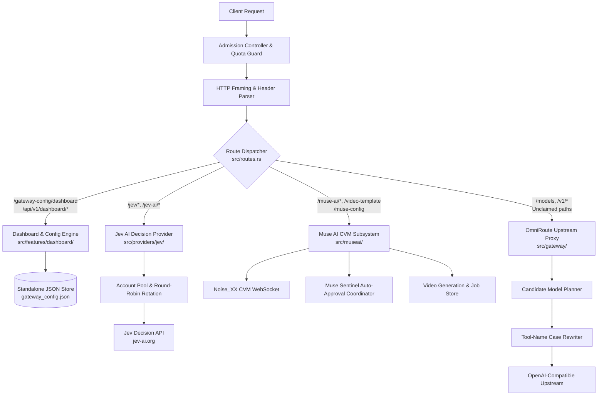

# Architecture

`toolcase-gateway` is a high-performance, zero-async, single-binary HTTP/1.1 reverse proxy written in 100% safe Rust (`#![forbid(unsafe_code)]`). It utilizes blocking I/O (`std::net` and `std::thread`) with admission control and no asynchronous runtime (zero `tokio`/`async-std`).

---

## 1. Subsystem Architecture

The gateway serves four cohesive subsystems behind an admission controller and exclusive, fail-closed router:

---

## 2. Route Ownership & Invariants

Dispatch in `src/routes.rs` is **exclusive and fail-closed**: a request matching a subsystem namespace is strictly handled or rejected within that subsystem. It **never falls through** to the generic OmniRoute proxy. Unknown paths under reserved namespaces return `404 Not Found`; mismatched HTTP methods return `405 Method Not Allowed`.

| Route | Subsystem / Owner | Allowed Methods | Purpose |
| :--- | :--- | :--- | :--- |
| `/gateway-config/dashboard` | Dashboard UI | `GET` | Interactive pipeline, provider pool, and configuration dashboard |
| `/api/v1/dashboard/overview` | Dashboard API | `GET` | Aggregated provider status, masked credentials, and live config |
| `/api/v1/dashboard/config` | Dashboard API | `POST` | Update gateway parameters (host, port, fallbacks, timeout) |
| `/api/v1/dashboard/muse-config` | Dashboard API | `POST` | Update Muse AI endpoints, tokens, cookies, approvals, video prompt |
| `/api/v1/dashboard/accounts` | Dashboard API | `POST` | Ingest multi-API keys/accounts into live rotation pools |
| `/jev/models`, `/jev/v1/models` | Jev Decision | `GET` | Supported Jev decision model catalog |
| `/jev/v1/systemone` | Jev Decision | `POST` | Jev Decision API (SystemOne schema: `state`, `questions`) |
| `/jev/v1/requests/{id}` | Jev Decision | `GET` | Decision request status lookup |
| `/jev/v1/requests/{id}/cancel` | Jev Decision | `POST` | Decision request cancellation |
| `/jev-ai/v1/*` | Jev Decision | `*` | Compatibility alias for `/jev/v1/*` |
| `/models`, `/v1/models` | OmniRoute | `GET` | OmniRoute upstream model catalog |
| `/v1/chat/completions` | OmniRoute | `POST` | OpenAI-compatible chat completions with model failover |
| `/prism-openai/v1/chat/completions` | Prism | `POST` | Direct Prism raw OpenAI completion endpoint |
| `/muse-ai/models`, `/muse-ai/v1/models` | Muse AI | `GET` | Local Muse model catalog (`muse`) |
| `/muse-ai/v1/chat/completions` | Muse AI | `POST` | Dedicated Muse chat completions (see [docs/muse-chat.md](muse-chat.md)) |
| `/muse-ai/v1` | Muse AI | `POST` | Raw Muse REST proxy endpoint |
| `/muse-ai/v1/create-image`, `/muse-ai/create-image`, `/v1/images/generations` | Muse Image | `POST` | Text-to-image creation with aspect ratio choices (`1:1`, `16:9`, etc.) |
| `/muse-ai/v1/images/{id}` | Muse Image | `GET` | Image job status polling and metadata |
| `/muse-ai/v1/images/{id}/content` | Muse Image Media | `GET`, `HEAD` | Preview image inline |
| `/muse-ai/v1/images/{id}/download` | Muse Image Media | `GET`, `HEAD` | Download image file |
| `/image-template` | Image Studio UI | `GET`, `HEAD` | Interactive image generation studio with aspect ratio pills, live preview, and download |
| `/muse-ai/v1/create-video` | Muse Video | `POST` | Video creation task submission |
| `/muse-ai/v1/videos/{id}` | Muse Video | `GET`, `POST` | Video job polling (`GET`) or edit prompt revision (`POST`) |
| `/muse-ai/v1/threads/{id}/cleanup` | Muse Threads | `POST` | Background worker thread registration and cleanup |
| `/muse-ai/v1/config` | Muse Config | `GET` | Effective masked Muse configuration snapshot |
| `/muse-ai/v1/config/har` | Muse Config | `POST` | DevTools HAR capture upload and credential extraction |
| `/muse-config` | Muse Config UI | `GET` | Web interface for DevTools HAR upload and import |
| `/video-template[/<name>]` | Video Studio UI | `GET` | Interactive video generation studio and template viewer |
| *All unclaimed paths* | OmniRoute Proxy | Any | Generic reverse proxy forwarding with model failover |

---

## 3. Core Subsystems

### A. Dashboard & Standalone Persistent Storage (`src/features/dashboard/`)
- **Single Page Application UI**: Served from [`assets/dashboard.html`](file:///home/ubuntu/toolcase-gateway-rs/assets/dashboard.html) at `/gateway-config/dashboard`. Zero external CDN or script dependencies.
- **Standalone JSON Store (`gateway_config.json`)**: Configuration is managed via [`PersistentConfig`](file:///home/ubuntu/toolcase-gateway-rs/src/config.rs). When updated from the dashboard or API, changes are applied immediately to the in-memory [`ConfigStore`](file:///home/ubuntu/toolcase-gateway-rs/src/config.rs) and persisted atomically via `fs::write` to a temporary file (`.gateway_config.json~tmp`), unix permissions `0600`, and `fs::rename`. The `.env` file is left untouched.
- **Credential Redaction**: API keys, bearer tokens, and session cookies are strictly masked (`mask_key`) in read responses (`sk-glm...d74b` or `***`). Full secrets are never emitted in API responses or log output.

### B. Jev AI Decision Engine & Account Pool (`src/providers/jev/`)
- **Decision Schema Handling**: Jev is a specialized decision service (using `state` and `questions` payload), not an OpenAI chat completion endpoint. OmniRoute chat transformations do not apply.
- **Multi-Account Rotation Pool (`JevAccountPool`)**: Rotates multiple configured API keys round-robin per request.
- **Automatic Account Failover**: Automatically rotates to the next candidate key when account errors occur (`401 Unauthorized`, `402 Payment Required`, `403 Forbidden`, `429 Rate Limit`).
- **Idempotency**: The `Idempotency-Key` HTTP header is preserved across account failovers to avoid duplicate billable decision execution.

### C. Muse AI Subsystem & Confidential VM Pipeline (`src/museai/`)
- **Noise Protocol Handshake**: End-to-end encrypted transport to Confidential VMs via `Noise_XX_25519_AESGCM_SHA256` (`src/museai/noise.rs`).
- **Sentinel Headless Auto-Approval Coordinator**: Manages auto-approval policies for outbound network requests without requiring interactive browser automation. Modes: `off` (fail-closed, prompts browser approval), `observe` (logs decisions), and `on` (`scoped-auto`, automatically approves destinations matching `allowed_destinations`).
- **Video Generation & Polling**: Handles video task submission, prompt revision tracking, artifact verification (`video_url`), and background thread cleanup (`src/museai/video.rs`, `src/museai/threads.rs`).

### D. OmniRoute Reverse Proxy (`src/gateway/`)
- **Candidate Model Planning**: Sequential candidate failover for transient or retryable errors (`401, 402, 403, 408, 429, 499, 500, 502, 503, 504, 524`). Non-retryable errors (`400 Bad Request`, `413 Payload Too Large`) fail immediately without consuming candidates.
- **Tool-Name Case Repair**: Scans request tool definitions and restores exact casing in streamed responses (e.g. `bash` -> `Bash`) to repair casing mutations introduced by certain upstream models.

---

## 4. Module Map & Responsibilities

The codebase follows strict Domain-Driven Design (DDD) with clear boundaries:

| Path | Purpose / Domain | Line Target |
| :--- | :--- | :--- |
| `src/main.rs` | CLI executable entry point, signals, server loop | <150 lines |
| `src/lib.rs` | Public library entry, bootstrap, and store initialization | <180 lines |
| `src/config.rs` | Configuration models, `PersistentConfig`, and `ConfigStore` | <480 lines |
| `src/routes.rs` | Canonical route dispatch and status code enforcement | <450 lines |
| `src/http.rs` | HTTP framing, header parsing, and write utilities | <400 lines |
| `src/har_config.rs` | DevTools HAR capture parser and credential extractor | <800 lines |
| `src/video_template.rs` | Handlers serving Video Studio and Muse Config HTML pages | <50 lines |
| `src/features/dashboard/mod.rs` | Dashboard feature facade and re-exports | <20 lines |
| `src/features/dashboard/service.rs` | Dashboard overview, gateway settings API, and account ingestion | <360 lines |
| `src/features/dashboard/muse.rs` | Muse AI config mutation handler and validation | <200 lines |
| `src/providers/jev/mod.rs` | Jev provider facade and exports | <30 lines |
| `src/providers/jev/adapter.rs` | Jev upstream transport, execution, and catalog handler | <160 lines |
| `src/providers/jev/accounts.rs` | Jev multi-account pool, round-robin, and failover state | <120 lines |
| `src/providers/jev/route.rs` | Jev route resolution and mapping | <60 lines |
| `src/providers/jev/business.rs` | Jev retryable status classifier | <30 lines |
| `src/museai/` | Muse AI subsystem: transport, noise, chat, video, approval, session | Decomposed <450/module |
| `src/gateway/` | Candidate planning, retry classification, policy rules, archive extractor, module installer | Decomposed <450/module |
| `src/runtime/` | Admission controller, byte guard, connection limits | Decomposed <450/module |
| `src/codecs/` | SSE and chunked streaming decoders | Decomposed <450/module |

For details on authoring, installing, and auto-discovering external provider modules (modeled after WordPress plugins and Odoo addons), consult [`docs/MODULES.md`](MODULES.md).

---

## 5. Architectural Invariants

1. **Zero External Async Runtime**: All I/O uses blocking `std::net::TcpStream` with thread-per-connection pools bounded by `GW_MAX_CONNECTIONS`. No `tokio`, `async-std`, or hidden event loops.
2. **`#![forbid(unsafe_code)]`**: Enforced compiler-wide in `Cargo.toml`. Zero unsafe blocks across the entire codebase.
3. **Zero New Dependencies**: Minimal, focused dependencies (`serde`, `serde_json`, `ureq`, `uuid`, `snow`, `tungstenite`, `dotenvy`). No external databases (e.g. SQLite); persistence is strictly file-based and atomic.
4. **Strict Modular Line Ceilings**: Target under 450 lines per module (soft ceiling 800 lines maximum). Monolithic files must be decomposed into focused submodules with facade re-exports.
5. **Fail-Closed Security**: Network bounds, URL schemes, and route namespaces fail closed by default.
