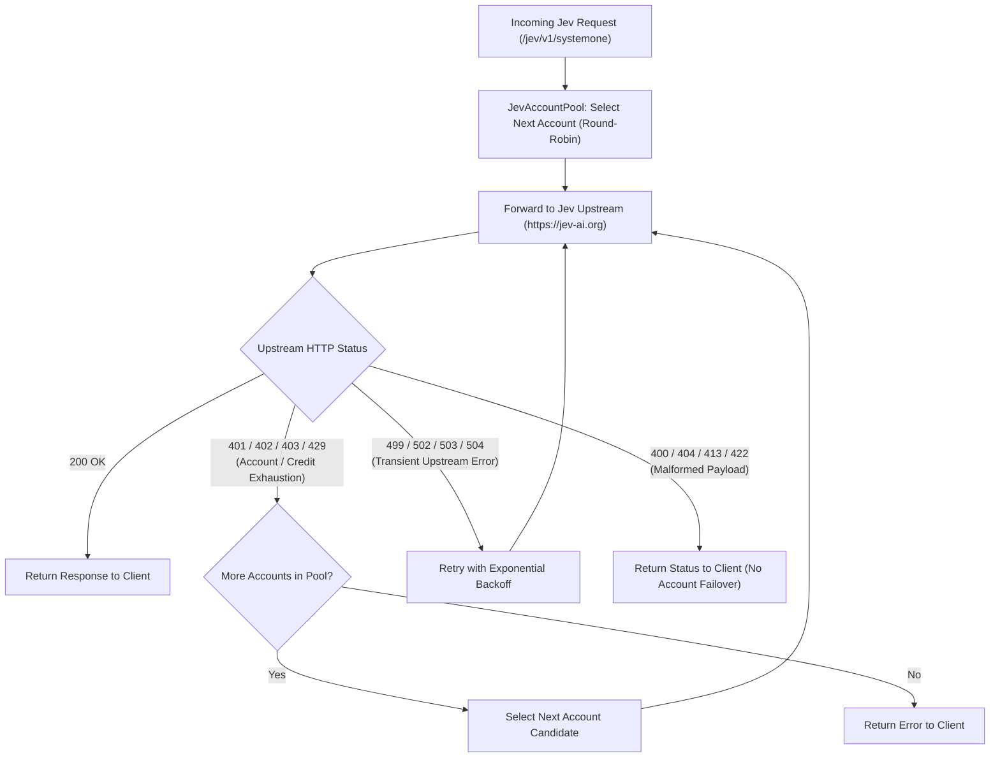

# Jev Decision API Integration

## 1. Overview

**Jev AI** is an asynchronous decision classification and evaluation engine. It is **not** an OpenAI-compatible conversational chat completion service.

Clients send structured decision payloads containing a contextual `state` and a set of `questions`. The gateway forwards this payload directly to Jev upstream endpoints, handles multi-account credit rotation, and returns Jev's structured decision responses.

### Why OmniRoute Cannot Handle Jev Requests

OmniRoute (`/v1/chat/completions`) is strictly optimized for OpenAI-style conversational message sequences (`[{"role": "user", "content": "..."}]`) and streams incremental token chunks while repairing tool/function name casing.

In contrast, Jev:
- Operates on decision graphs (`state` string + `questions` schema map).
- Evaluates categorical, boolean, or multi-option questions against the context.
- Returns comprehensive decision evaluations and confidence metrics.
- Uses dedicated REST endpoints (`/api/v1/systemone/`, `/api/v1/models/`, `/api/v1/requests/{id}/`).

Therefore, Jev traffic is routed through dedicated gateway endpoints under `/jev/v1/*` (or `/jev-ai/v1/*`), backed by a dedicated account pool (`JevAccountPool`).

---

## 2. Configuration & Account Management

### Configuration Methods

You can configure Jev API keys statically or dynamically:

1. **Dynamic Dashboard Management (Recommended)**:
   - Open `/gateway-config/dashboard` in your browser.
   - Paste one or more Jev API keys under the **Provider Accounts** section.
   - Keys are immediately activated in memory and persisted to `gateway_config.json` with POSIX `0600` permissions (never modifying `.env`).
   - Or use the REST endpoint:
     ```bash
     curl -X POST http://127.0.0.1:20129/api/v1/dashboard/accounts \
       -H "Content-Type: application/json" \
       -d '{
         "provider": "jev",
         "api_keys": ["sk-jev-account1-...", "sk-jev-account2-..."]
       }'
     ```

2. **Environment Variables**:
   ```bash
   GW_JEV_API_KEYS="<key-1>,<key-2>,<key-3>"
   GW_JEV_BASE_URL="https://jev-ai.org"
   ```

3. **Per-Request Headers (Fallback)**:
   When no accounts are pre-configured on the gateway, requests can pass an account key directly using:
   - `Authorization: Bearer <key>`
   - `x-api-key: <key>`

---

## 3. Account Pool Rotation & Automatic Failover

The gateway maintains a thread-safe `JevAccountPool`:



- **Round-Robin Rotation**: Distributes requests evenly across all configured accounts to maximize available free credit allowances (e.g. Jev AI Tools daily allowances, Space welcome credits).
- **Credit & Auth Failover**: If an account returns `401 Unauthorized`, `402 Payment Required` (credits exhausted), `403 Forbidden`, or `429 Too Many Requests`, the gateway immediately switches to the next account candidate.
- **Fail-Closed on Bad Input**: Malformed inputs (`400 Bad Request`, `404 Not Found`, `413 Payload Too Large`, `422 Unprocessable Entity`) fail immediately without rotating accounts, preventing capacity waste.
- **Idempotency Protection**: When an `Idempotency-Key` header is present, it is forwarded across account retries to prevent duplicate billing.

---

## 4. Endpoints & Route Mapping

The gateway normalizes inbound paths and maps them to canonical upstream Jev endpoints (including required trailing slashes):

| Gateway Route | Method | Jev Upstream Route | Description |
| :--- | :--- | :--- | :--- |
| `/jev/v1/systemone` | `POST` | `/api/v1/systemone/` | Submit a decision classification task |
| `/jev/v1/models` | `GET` | `/api/v1/models/` | List supported decision models |
| `/jev/v1/requests/{id}` | `GET` | `/api/v1/requests/{id}/` | Poll the status of an asynchronous decision |
| `/jev/v1/requests/{id}/cancel` | `POST` | `/api/v1/requests/{id}/cancel/` | Cancel an active decision request |

> [!NOTE]
> The prefix `/jev-ai/v1/` is supported as an exact alias for `/jev/v1/`.

---

## 5. Decision Request & Response Examples

### SystemOne Decision Request

```bash
curl -X POST "http://127.0.0.1:20129/jev/v1/systemone" \
  -H "Content-Type: application/json" \
  -H "Idempotency-Key: ticket-8814-20261010" \
  -d '{
    "model": "jev-1.13",
    "state": "A customer wants a refund for a damaged product delivered three days ago.",
    "questions": {
      "is_refund": {
        "type": "noul",
        "instructions": "Is the customer requesting a refund?"
      },
      "urgency": {
        "type": "options",
        "options": ["low", "medium", "high", "critical"],
        "instructions": "Determine the urgency level of the request."
      }
    }
  }'
```

### Request Fields

| Field | Type | Required | Description |
| :--- | :--- | :--- | :--- |
| `model` | string | Yes | Target decision model (e.g. `jev-1.13`). |
| `state` | string | Yes | Natural language text or context describing the situation to evaluate. |
| `questions` | object | Yes | Key-value mapping of question IDs to question definitions. |
| `questions.<key>.type` | string | Yes | Question evaluation type: `"noul"` (boolean yes/no) or `"options"` (categorical selection). |
| `questions.<key>.instructions` | string | Yes | Clear prompt directing the model on how to evaluate the state. |
| `questions.<key>.options` | array | For `"options"` | List of valid categorical outcomes. |

### SystemOne Decision Response (`200 OK`)

```json
{
  "request_id": "req-98234-abcd",
  "model": "jev-1.13",
  "status": "completed",
  "results": {
    "is_refund": {
      "answer": true,
      "confidence": 0.99,
      "reasoning": "The user explicitly states they want a refund for the delivered item."
    },
    "urgency": {
      "answer": "medium",
      "confidence": 0.88,
      "reasoning": "Product delivery occurred 3 days ago; standard refund window applies."
    }
  },
  "usage": {
    "billed_credits": 1
  }
}
```

---

## 6. Querying Models & Status

### Query Available Models

```bash
curl -X GET "http://127.0.0.1:20129/jev/v1/models"
```

Response:
```json
{
  "object": "list",
  "data": [
    {
      "id": "jev-1.13",
      "object": "model",
      "type": "decision",
      "owned_by": "jev"
    }
  ]
}
```

### Query Request Status

```bash
curl -X GET "http://127.0.0.1:20129/jev/v1/requests/req-98234-abcd"
```

### Cancel Request

```bash
curl -X POST "http://127.0.0.1:20129/jev/v1/requests/req-98234-abcd/cancel"
```

---

## 7. Billing & Operational Guidance

- **Billable Actions**: Jev bills accounts only for successful `200 OK` decision evaluations.
- **Free Actions**: Calling `/jev/v1/models`, checking status via `GET /jev/v1/requests/{id}`, or cancelling jobs are free and consume no credits.
- **Fail-Closed Safety**: Requests with missing fields, invalid question types, or empty states return `400 Bad Request` and do not consume credits or cause account failovers.
