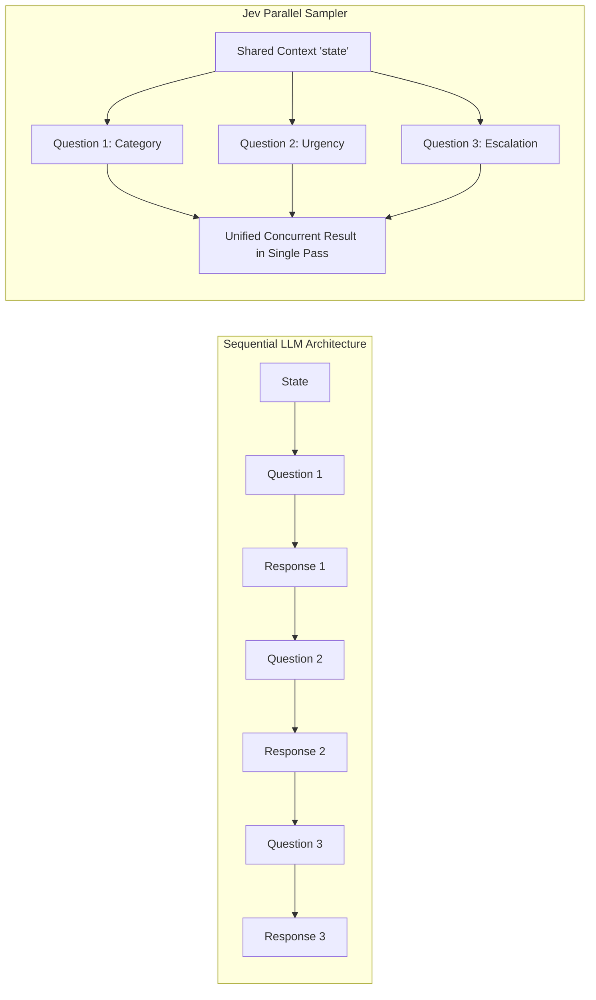
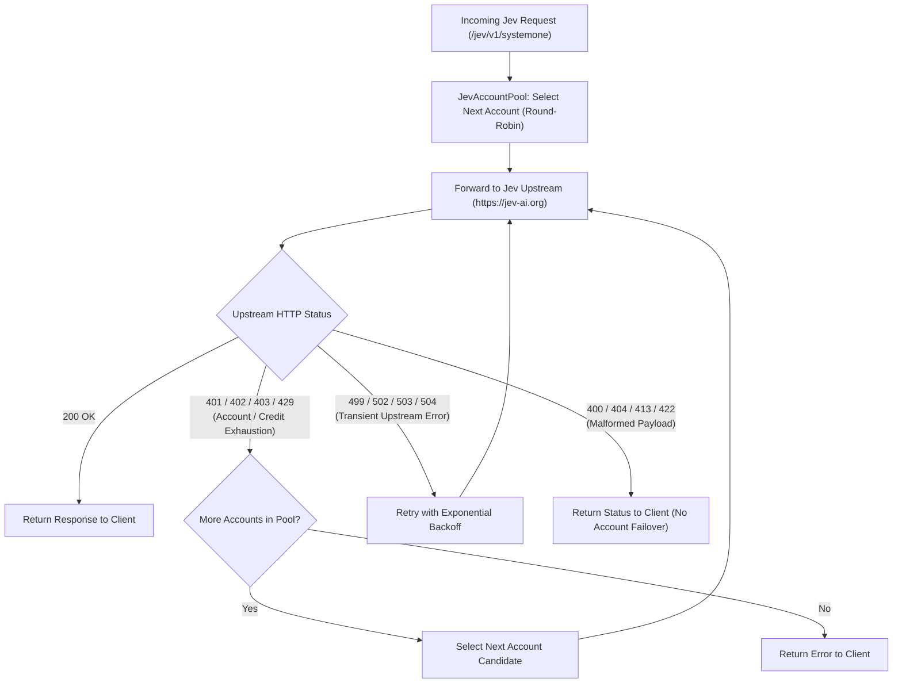

# Jev Decision API Integration

## 1. Overview

**Jev AI** is an asynchronous decision classification and evaluation engine. It is **not** an OpenAI-compatible conversational chat completion service.

Clients send structured decision payloads containing a contextual `state` and a set of `questions`. The gateway forwards this payload directly to Jev upstream endpoints, handles multi-account credit rotation, and returns Jev's structured decision responses.

### The Parallel Sampler: Concurrent Multi-Question Evaluation

You can ask multiple questions simultaneously in a single call. This is a core architectural capability of Jev's **Parallel Sampler**: the model evaluates all questions across the same shared context (`state`) concurrently in a single pass, eliminating the compounding sequential latency typical of autoregressive LLMs.



### Why OmniRoute Cannot Handle Jev Requests

OmniRoute (`/v1/chat/completions`) is strictly optimized for OpenAI-style conversational message sequences (`[{"role": "user", "content": "..."}]`) and streams incremental token chunks while repairing tool/function name casing.

In contrast, Jev:
- Operates on decision graphs (`state` object/string + `questions` schema map).
- Concurrently evaluates categorical choices, scores, or boolean questions against shared context.
- Returns comprehensive decision evaluations and confidence metrics.
- Uses dedicated REST endpoints (`/api/v1/systemone/`, `/api/v1/models/`, `/api/v1/requests/{id}/`).

Therefore, Jev traffic is routed through dedicated gateway endpoints under `/jev/v1/*` (or `/jev-ai/v1/*`), backed by a dedicated account pool (`JevAccountPool`).

---

## 2. Standard Structure of `POST /jev/v1/systemone`

The endpoint expects a JSON payload containing exactly two top-level components (`state` and `questions`):

```json
{
  "state": {
    "task": "Customer requesting a refund due to duplicate credit card charges",
    "customer_tier": "VIP",
    "previous_tickets_count": 0
  },
  "questions": {
    "category": {
      "type": "choice",
      "instructions": "Identify the primary topic of the customer's request.",
      "criteria": {
        "billing": "Charges, payments, invoices, refunds, pricing, or subscription fees.",
        "technical": "A product feature is broken, failing, unavailable, or behaving unexpectedly.",
        "account": "Sign-in, password, profile, access permissions, or account administration."
      }
    },
    "urgency": {
      "type": "score",
      "instructions": "Score the urgency level on a scale from 0 to 3 based on impact and timing.",
      "criteria": [
        "0: Routine question or informational inquiry; no operational disruption.",
        "1: Degraded experience, but core functionality remains fully usable.",
        "2: Blocks core workflow or involves pending financial/transactional hold-ups.",
        "3: Critical operational stoppage or severe risk of active financial loss."
      ]
    },
    "needs_escalation": {
      "type": "noul",
      "instructions": "Does this request require direct escalation to a team lead or manager?"
    }
  }
}
```

> [!TIP]
> You may optionally include `"model": "jev-1.13"` in the request root if you wish to target a specific model release. When omitted, Jev routes to the default calibrated engine.

### Supported Question Types & Capacity Limits

Jev strictly supports exactly three question types:

| Type | Description | Criteria Format | Example Return |
| :--- | :--- | :--- | :--- |
| `noul` | Binary determination (Yes/No, True/False) | None required. Simply provide `instructions`. | `{"noul": 0.88}` (probability between 0.0 and 1.0) |
| `choice` | Categorical classification | Object mapping each candidate label to its semantic definition. | `{"choice": "billing", "probabilities": {...}, "confidence": 1.0}` |
| `score` | Calibrated integer scoring scale (e.g. 0–3, 0–4) | Array of anchor strings defining each discrete score level. | `{"score": 2.05, "probabilities": {...}, "confidence": 0.87}` |

> [!WARNING]
> Do not use `"type": "boolean"`. Jev uses `"type": "noul"` for binary/boolean questions. If you need explicit custom criteria for binary states, use `"type": "choice"` with two candidate keys (e.g. `"escalate"` and `"standard"`).

> [!NOTE]
> **Batching Limits**: Jev supports evaluating up to **20 questions simultaneously** per request across a context of up to 32,000 tokens (100,000 characters). All questions in the batch are processed in a single pass without adding compounding sequential latency.

---

## 3. Context Engineering: Structuring `state` for High-Accuracy Decisions

Because Jev is a **System 1 evaluation model** (calibrated pattern matching and probabilistic mapping) rather than a freeform generative chat model, output fidelity depends directly on how the input is normalized.

### Technique 1: Supply Hierarchical JSON Over Raw Text

Avoid passing long, unstructured text blobs. Group information into discrete semantic dimensions:

- **Suboptimal (Unstructured narrative):**
  > *"Customer A emailed today saying their payment failed. They are a VIP user who registered back in 2024..."*

- **Optimal (Structured key-value properties):**
  ```json
  "state": {
    "raw_message": "I was charged twice on my Visa card for this cycle...",
    "entity_info": { "tier": "Enterprise", "arr": 24000 },
    "system_flags": { "recent_payment_failed": true }
  }
  ```

Jev maps structured key-value inputs to question criteria significantly faster and with higher precision than raw prose.

### Technique 2: Deconstruct Complex Intents (Question Decomposition)

Never combine multiple evaluation criteria into a single question (e.g., avoid *"Is this a severe technical issue?"*). Decompose the evaluation into independent dimensions:

- **Question 1 (`choice`):** Department assignment (`technical`, `billing`, `account`).
- **Question 2 (`score`):** Operational severity (`severity` on a 0–3 or 0–4 rubric).
- **Question 3 (`noul`):** Regulatory or compliance risk (`compliance_risk`).

Decomposition allows the parallel sampler to compute independent probability distributions for each axis without cross-intent contamination.

### Technique 3: Formulate MECE Rubrics and Anchors

Model calibration depends on unambiguous boundaries between candidates:

- **Eliminate vague adjectives:** Avoid subjective terminology such as *"somewhat urgent"*, *"fairly critical"*, or *"normal"*.
- **Anchor to concrete criteria:**
  - **For `score`:** Anchor each integer level to an explicit system or business state (e.g., `0 = general query`, `1 = cosmetic UI defect`, `2 = checkout conversion blocker`, `3 = global service outage`).
  - **For `choice`:** Always provide an explicit fallback option (such as `other` or `unspecified`) with defined scope, giving the model an explicit sink for probability density when inputs fall outside the main categories.

### Technique 4: Decouple Signal Extraction from Business Policy

Do not attempt to embed routing decisions or execution logic inside the prompt instructions. Use Jev strictly to produce objective probabilistic signals, and enforce decision logic deterministically in code:

```typescript
// Jev returns calibrated signals:
// urgency.score = 2.7 / 3
// needs_escalation.probability = 0.88
// category.choice = "billing" (p = 0.94)

// Your application applies the business policy deterministically:
if (answers.category.choice === 'billing' && answers.urgency.score >= 2.0) {
  if (answers.needs_escalation.probability > 0.8) {
    assignToLeadSupport(state.ticket_id);
  } else {
    assignToStandardBillingQueue(state.ticket_id);
  }
}
```

---

## 4. Configuration & Account Management

### Configuration Methods

You can configure Jev API keys statically or dynamically:

1. **Dynamic Dashboard Management (Recommended)**:
   - Open `/gateway-config/dashboard` in your browser.
   - Paste one or more Jev API keys under the **Add Multi API Keys / Accounts** section, with an optional account label.
   - Keys and labels are immediately activated in memory and persisted to `gateway_config.json` with POSIX `0600` permissions (never modifying `.env`).
   - Or use the REST endpoint:
     ```bash
     curl -X POST http://127.0.0.1:20129/api/v1/dashboard/accounts \
       -H "Content-Type: application/json" \
       -d '{
         "provider": "jev",
         "label": "primary-cluster",
         "api_keys": ["sk-jev-account1-...", "sk-jev-account2-..."]
       }'
     ```
     You can also supply structured accounts or inline labels:
     ```bash
     curl -X POST http://127.0.0.1:20129/api/v1/dashboard/accounts \
       -H "Content-Type: application/json" \
       -d '{
         "provider": "jev",
         "accounts": [
           { "key": "sk-jev-account1-...", "label": "prod-worker-1" },
           { "key": "sk-jev-account2-...", "label": "prod-worker-2" }
         ]
       }'
     ```

2. **Environment Variables**:
   ```bash
   GW_JEV_API_KEYS="primary:sk-key-1,secondary:sk-key-2,sk-key-3"
   GW_JEV_BASE_URL="https://jev-ai.org"
   ```

3. **Per-Request Headers (Fallback)**:
   When no accounts are pre-configured on the gateway, requests can pass an account key directly using:
   - `Authorization: Bearer <key>`
   - `x-api-key: <key>`

---

## 5. Account Pool Rotation & Automatic Failover

The gateway maintains a thread-safe `JevAccountPool`:



- **Round-Robin Rotation**: Distributes requests evenly across all configured accounts to maximize available free credit allowances (e.g. Jev AI Tools daily allowances, Space welcome credits).
- **Credit & Auth Failover**: If an account returns `401 Unauthorized`, `402 Payment Required` (credits exhausted), `403 Forbidden`, or `429 Too Many Requests`, the gateway immediately switches to the next account candidate.
- **Fail-Closed on Bad Input**: Malformed inputs (`400 Bad Request`, `404 Not Found`, `413 Payload Too Large`, `422 Unprocessable Entity`) fail immediately without rotating accounts, preventing capacity waste.
- **Idempotency Protection**: When an `Idempotency-Key` header is present, it is forwarded across account retries to prevent duplicate billing.

---

## 6. Endpoints & Route Mapping

The gateway normalizes inbound paths and maps them to canonical upstream Jev endpoints (including required trailing slashes):

| Gateway Route | Method | Jev Upstream Route | Description |
| :--- | :--- | :--- | :--- |
| `/jev/v1/systemone` | `POST` | `/api/v1/systemone/` | Submit a decision classification task |
| `/jev/v1/models` | `GET` | `/api/v1/models/` | List supported decision models |
| `/jev/v1/requests/{id}` | `GET` | `/api/v1/requests/{id}/` | Poll the status of an asynchronous decision |
| `/jev/v1/requests/{id}/cancel` | `POST` | `/api/v1/requests/{id}/cancel/` | Cancel an active decision request |

> [!NOTE]
> The prefix `/jev-ai/v1/` is supported as an exact alias for `/jev/v1/`.

---

## 7. Multi-Question Example

### Parallel Decision Curl Request

```bash
curl -X POST "http://127.0.0.1:20129/jev/v1/systemone" \
  -H "Content-Type: application/json" \
  -H "Idempotency-Key: ticket-8814-20261010" \
  -d '{
    "model": "jev-1.13",
    "state": {
      "task": "Customer requesting a refund due to duplicate credit card charges",
      "customer_tier": "VIP",
      "previous_tickets_count": 0
    },
    "questions": {
      "category": {
        "type": "choice",
        "instructions": "Identify the primary topic of the customer'\''s request.",
        "criteria": {
          "billing": "Charges, payments, invoices, refunds, pricing, or subscription fees.",
          "technical": "A product feature is broken, failing, unavailable, or behaving unexpectedly.",
          "account": "Sign-in, password, profile, access permissions, or account administration."
        }
      },
      "urgency": {
        "type": "score",
        "instructions": "Score the urgency level on a scale from 0 to 3 based on impact and timing.",
        "criteria": [
          "0: Routine question or informational inquiry; no operational disruption.",
          "1: Degraded experience, but core functionality remains fully usable.",
          "2: Blocks core workflow or involves pending financial/transactional hold-ups.",
          "3: Critical operational stoppage or severe risk of active financial loss."
        ]
      },
      "needs_escalation": {
        "type": "noul",
        "instructions": "Does this request require direct escalation to a team lead or manager?"
      }
    }
  }'
```

### SystemOne Decision Response (`200 OK`)

```json
{
  "id": "dec_a91d217f3cee804fc3fd6ba4",
  "model": "jev-1.13",
  "model_version": "jev-1.13-20260917",
  "provider": "jev-ai.org",
  "answers": {
    "category": {
      "type": "choice",
      "choice": "billing",
      "probabilities": {
        "billing": 1.0,
        "technical": 0.0,
        "account": 0.0
      },
      "confidence": 1.0
    },
    "urgency": {
      "type": "score",
      "score": 2.09,
      "legend": {
        "0": "0: Routine question or informational inquiry; no disruption.",
        "1": "1: Degraded experience, but core functionality remains usable.",
        "2": "2: Blocks core workflow or involves pending financial hold-ups.",
        "3": "3: Critical operational stoppage or severe risk of active loss."
      },
      "probabilities": {
        "0": 0.0,
        "1": 0.07,
        "2": 0.76,
        "3": 0.17
      },
      "confidence": 0.76
    },
    "needs_escalation": {
      "type": "noul",
      "noul": 0.12
    }
  },
  "usage": {
    "input_tokens": 498,
    "output_tokens": 53,
    "charged_tokens": 0,
    "charged_credits": 1,
    "wallet": "credits"
  },
  "latency_ms": 364
}
```

---

## 8. Querying Models & Status

### Query Available Models

```bash
curl -X GET "http://127.0.0.1:20129/jev/v1/models"
```

Response:
```json
{
  "object": "list",
  "data": [
    {
      "id": "jev-1.13",
      "object": "model",
      "type": "decision",
      "endpoint": "/api/v1/systemone",
      "question_types": ["noul", "choice", "score"],
      "limits": {
        "context_tokens": 32000,
        "max_questions": 20,
        "max_state_chars": 100000,
        "min_choice_labels": 2,
        "max_choice_labels": 24,
        "min_score_tiers": 2,
        "max_score_tiers": 10
      },
      "billing": {
        "credits_per_call_without_tokens": 1,
        "failed_requests_billed": false
      }
    },
    {
      "id": "jev-latest",
      "object": "model",
      "type": "decision",
      "endpoint": "/api/v1/systemone",
      "rolling": true
    }
  ]
}
```

### Query Request Status

```bash
curl -X GET "http://127.0.0.1:20129/jev/v1/requests/req-98234-abcd"
```

### Cancel Request

```bash
curl -X POST "http://127.0.0.1:20129/jev/v1/requests/req-98234-abcd/cancel"
```

---

## 9. Billing & Operational Guidance

- **Single Billed Credit**: Because the Parallel Sampler evaluates all concurrent questions in a single pass over the shared context, multi-question payloads consume only 1 credit per successful evaluation.
- **Free Endpoints**: Calling `/jev/v1/models`, checking status via `GET /jev/v1/requests/{id}`, or cancelling jobs are free and consume no credits.
- **Fail-Closed Safety**: Requests with missing fields, invalid question types, or empty states return `400 Bad Request` and do not consume credits or trigger account failovers.
