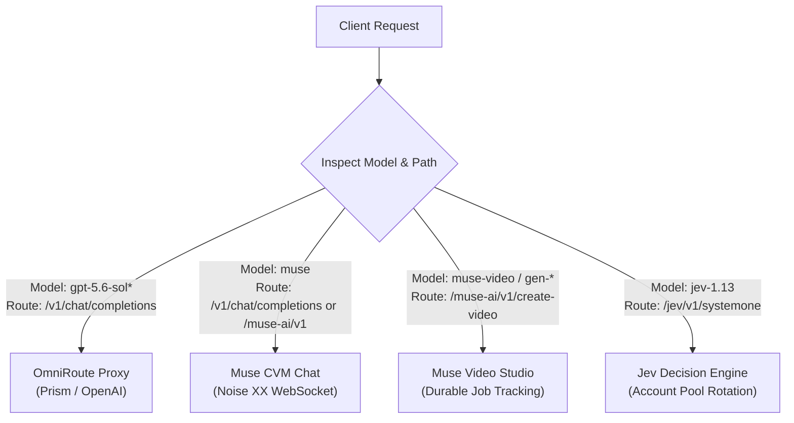

# Models Reference

Toolcase Gateway exposes multi-provider model routing, translating client requests to OpenAI-compatible proxies, Muse.ai Confidential VMs, or Jev AI decision networks.

---

## 1. Unified Model Catalog

| Model ID | Provider / Engine | Protocol / Target | Primary Capability | Catalog Route |
| :--- | :--- | :--- | :--- | :--- |
| `gpt-5.6-sol` | OpenAI / Prism | HTTP / OmniRoute | General conversational & tool use | `/v1/models` |
| `gpt-5.6-sol-low` | OpenAI / Prism | HTTP / OmniRoute | Low reasoning effort | `/v1/models` |
| `gpt-5.6-sol-medium` | OpenAI / Prism | HTTP / OmniRoute | Medium reasoning effort | `/v1/models` |
| `gpt-5.6-sol-high` | OpenAI / Prism | HTTP / OmniRoute | High reasoning effort | `/v1/models` |
| `gpt-5.6-sol-xhigh` | OpenAI / Prism | HTTP / OmniRoute | Extra-high reasoning effort | `/v1/models` |
| `muse` | Muse.ai | Noise XX / WebSocket | Conversational chat via CVM | `/v1/models`, `/muse-ai/v1/models` |
| `muse-video` | Muse.ai Video | Noise / Sentinel | Text-to-video synthesis (Default) | `/video/v1/providers` |
| `gen-3`, `gen-4`, `kling` | Muse Compatibility | Noise / Sentinel | Video synthesis aliases | `/video/v1/providers` |
| `jev-1.13` | Jev AI | HTTP REST / Jev Pool | Decision & classification analysis | `/jev/v1/models` |

---

## 2. Model Routing Matrix & Endpoints

Different model families serve distinct architectural paradigms and cannot be interchanged across route types:



### Routing Rules

1. **Conversational Chat Models (`gpt-5.6-sol*`, `muse`)**:
   - Must be dispatched to `POST /v1/chat/completions`.
   - Support tool definitions, stream deltas, and automatic tool-name casing restoration.
   - If `muse` encounters a connection failure, OmniRoute automatically retries using fallback models configured in `GW_FALLBACK_MODELS`.

2. **Video Generation Models (`muse-video`, `gen-3`, `gen-4`, `kling`)**:
   - Must be dispatched to `POST /muse-ai/v1/create-video`.
   - Take structured parameters (`prompt`, `aspect_ratio`, `duration`).
   - Managed under the Muse Sentinel auto-approval coordinator.

3. **Decision Models (`jev-1.13`)**:
   - Must be dispatched to `POST /jev/v1/systemone`.
   - Require structured decision payloads (`state` context and `questions` map).
   - Cannot be sent to `/v1/chat/completions` (will return HTTP 404/405).

---

## 3. Provider Details

### 3.1 OpenAI / Prism Models

These models map requests to an upstream OpenAI-compatible platform (such as Prism) with transparent tool-name repair and candidate failovers.

#### Reasoning Variants
- `gpt-5.6-sol`: Default balanced model for general agentic tasks and tool execution.
- `gpt-5.6-sol-low`: Fast, cost-efficient reasoning for straightforward transformations.
- `gpt-5.6-sol-medium`: Standard reasoning depth.
- `gpt-5.6-sol-high`: Deep reasoning for architectural planning and complex debugging.
- `gpt-5.6-sol-xhigh`: Maximum reasoning budget for exhaustive verification.

#### Example Request
```bash
curl -X POST http://127.0.0.1:20129/v1/chat/completions \
  -H "Content-Type: application/json" \
  -d '{
    "model": "gpt-5.6-sol-high",
    "messages": [
      {"role": "user", "content": "Analyze the time complexity of quicksort in the worst case."}
    ]
  }'
```

---

### 3.2 Muse.ai Conversational Model (`muse`)

The `muse` model routes standard OpenAI requests through a native, end-to-end encrypted WebSocket connection directly to a Muse Confidential VM (CVM).

#### Cryptographic Architecture
1. **VM Wake & Notary Token**: Wakes the remote CVM via `POST /api/hatch/vm/wake` and fetches a notary token from `POST /api/hatch/token`.
2. **Noise XX Handshake**: Performs a 3-way mutual handshake (`Noise_XX_25519_AESGCM_SHA256`) using ephemeral Curve25519 keys.
3. **Protobuf Binary Framing**: Encapsulates conversational messages into binary `ServiceFrame` structures.
4. **SSE Delta Extraction**: Gathers `delta.text_append` events from Stream 2 and reconstructs OpenAI-compliant SSE streams or buffered responses.

#### Example Request
```bash
curl -X POST http://127.0.0.1:20129/v1/chat/completions \
  -H "Content-Type: application/json" \
  -d '{
    "model": "muse",
    "messages": [
      {"role": "user", "content": "Reply with MUSE_OK"}
    ]
  }'
```

---

### 3.3 Muse.ai Video Generation Models

Dedicated video synthesis models dispatched through `/muse-ai/v1/create-video`.

#### Supported Video Model Names
- `muse-video` (Canonical default)
- Compatibility aliases: `muse`, `gen-3`, `gen-2`, `kling`, `gen-4`, `gen-4.5`, `gen-4-turbo`, `aleph-2.0`, `ruby`

#### Example Request
```bash
curl -X POST http://127.0.0.1:20129/muse-ai/v1/create-video \
  -H "Content-Type: application/json" \
  -d '{
    "model": "muse-video",
    "prompt": "Cinematic shot of an orange fox skateboarding across a sunlit bridge, photorealistic, 4k.",
    "aspect_ratio": "16:9",
    "duration": 5
  }'
```

---

### 3.4 Jev AI Decision Models (`jev-1.13`)

Jev models perform asynchronous decision classification and multi-question evaluation.

#### Example Request
```bash
curl -X POST "http://127.0.0.1:20129/jev/v1/systemone" \
  -H "Content-Type: application/json" \
  -H "Idempotency-Key: ticket-8814-20261010" \
  -d '{
    "model": "jev-1.13",
    "state": "Customer has filed three warranty claims in the last 14 days.",
    "questions": {
      "potential_fraud": {
        "type": "noul",
        "instructions": "Does this activity pattern indicate potential warranty fraud?"
      }
    }
  }'
```

---

## 4. Model Catalog Endpoints

| Catalog Route | HTTP Method | Scope | Returned Structure |
| :--- | :--- | :--- | :--- |
| `/v1/models` | `GET` | Global conversational models | `{"object": "list", "data": [{"id": "gpt-5.6-sol", ...}, {"id": "muse", ...}]}` |
| `/muse-ai/v1/models` | `GET` | Scoped Muse conversational model | `{"object": "list", "data": [{"id": "muse", ...}]}` |
| `/jev/v1/models` | `GET` | Active Jev decision models | `{"object": "list", "data": [{"id": "jev-1.13", ...}]}` |
| `/video/v1/providers` | `GET` | Supported video engines | `{"object": "list", "data": [{"id": "muse_chat", ...}]}` |
