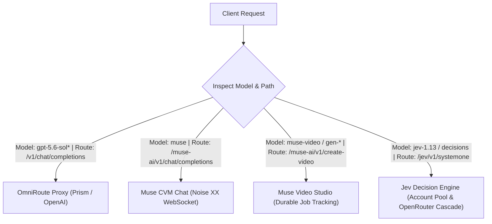

# Models Reference

Toolcase Gateway exposes multi-provider model routing, translating client requests to OpenAI-compatible proxies, Muse.ai Confidential VMs, or Jev AI decision networks.

---

## 1. Unified Model Catalog

| Model ID | Provider / Engine | Protocol / Target | Primary Capability | Catalog Route |
| :--- | :--- | :--- | :--- | :--- |
| `gpt-5.6-sol` | OpenAI / Prism | HTTP / OmniRoute | General conversational & tool use | `/v1/models` |
| `gpt-5.6-sol-low` | OpenAI / Prism | HTTP / OmniRoute | Low reasoning effort | `/v1/models` |
| `gpt-5.6-sol-medium` | OpenAI / Prism | HTTP / OmniRoute | Medium reasoning effort | `/v1/models` |
| `gpt-5.6-sol-high` | OpenAI / Prism | HTTP / OmniRoute | High reasoning effort | `/v1/models` |
| `gpt-5.6-sol-xhigh` | OpenAI / Prism | HTTP / OmniRoute | Extra-high reasoning effort | `/v1/models` |
| `muse` | Muse.ai | Noise XX / WebSocket | Conversational chat via CVM | `/v1/models`, `/muse-ai/v1/models` |
| `muse-image` | Muse.ai Image | Noise / REST | Text-to-image synthesis with aspect ratios | `/muse-ai/v1/create-image`, `/v1/images/generations` |
| `muse-video` | Muse.ai Video | Noise / Sentinel | Text-to-video synthesis (Default) | `/video/v1/providers` |
| `gen-3`, `gen-4`, `kling` | Muse Compatibility | Noise / Sentinel | Video synthesis aliases | `/video/v1/providers` |
| `jev-1.13`, `typesafe/jev-1.13` | Jev AI / OpenRouter | HTTP REST / Failover Pool | Decision & classification analysis | `/jev/v1/models` |

---

## 2. Model Routing Matrix & Endpoints

Different model families serve distinct architectural paradigms and cannot be interchanged across route types:



### Routing Rules

1. **Conversational Chat Models (`gpt-5.6-sol*`, `muse`)**:
   - `muse` can be dispatched directly to `POST /muse-ai/v1/chat/completions` or globally to `POST /v1/chat/completions`.
   - Support tool definitions, stream deltas, and automatic tool-name casing restoration.
   - If `muse` encounters a connection failure, OmniRoute automatically retries using fallback models configured in `GW_FALLBACK_MODELS`.

2. **Video Generation Models (`muse-video`, `gen-3`, `gen-4`, `kling`)**:
   - Must be dispatched to `POST /muse-ai/v1/create-video`.
   - Take structured parameters (`prompt`, `aspect_ratio`, `duration`).
   - Managed under the Muse Sentinel auto-approval coordinator.

3. **Decision Models (`jev-1.13`, `typesafe/jev-1.13`, and OpenRouter Fallback Models)**:
   - Must be dispatched to `POST /jev/v1/systemone` or `POST /jev/v1/decisions`.
   - Require structured decision payloads (`state` context and `questions` map).
   - Support a 4-tier cascade: Direct Jev -> Jev OpenRouter API Key -> OpenRouter Different Decision -> OpenRouter Browser Cookie.
   - Cannot be sent to `/v1/chat/completions` (will return HTTP 404/405).

---

## 3. Provider Details

### 3.1 OpenAI / Prism Models

These models map requests to an upstream OpenAI-compatible platform (such as Prism) with transparent tool-name repair and candidate failovers.

#### Reasoning Variants
- `gpt-5.6-sol`: Default balanced model for general agentic tasks and tool execution.
- `gpt-5.6-sol-low`: Fast, cost-efficient reasoning for straightforward transformations.
- `gpt-5.6-sol-medium`: Standard reasoning depth.
- `gpt-5.6-sol-high`: Deep reasoning for architectural planning and complex debugging.
- `gpt-5.6-sol-xhigh`: Maximum reasoning budget for exhaustive verification.

#### Example Request
```bash
curl -X POST http://127.0.0.1:20129/v1/chat/completions \
  -H "Content-Type: application/json" \
  -d '{
    "model": "gpt-5.6-sol-high",
    "messages": [
      {"role": "user", "content": "Analyze the time complexity of quicksort in the worst case."}
    ]
  }'
```

---

### 3.2 Muse.ai Conversational Model (`muse`)

The `muse` model routes standard OpenAI requests through a native, end-to-end encrypted WebSocket connection directly to a Muse Confidential VM (CVM). See [`docs/muse-chat.md`](muse-chat.md) for the full conversational chat guide.

#### Cryptographic Architecture
1. **VM Wake & Notary Token**: Wakes the remote CVM via `POST /api/hatch/vm/wake` and fetches a notary token from `POST /api/hatch/token`.
2. **Noise XX Handshake**: Performs a 3-way mutual handshake (`Noise_XX_25519_AESGCM_SHA256`) using ephemeral Curve25519 keys.
3. **Protobuf Binary Framing**: Encapsulates conversational messages into binary `ServiceFrame` structures.
4. **SSE Delta Extraction**: Gathers `delta.text_append` events from Stream 2 and reconstructs OpenAI-compliant SSE streams or buffered responses.

#### Example Request
```bash
# Dedicated Muse chat completions route
curl -X POST http://127.0.0.1:20129/muse-ai/v1/chat/completions \
  -H "Content-Type: application/json" \
  -d '{
    "model": "muse",
    "messages": [
      {"role": "user", "content": "Reply with MUSE_OK"}
    ]
  }'

# Or via global OpenAI completions route
curl -X POST http://127.0.0.1:20129/v1/chat/completions \
  -H "Content-Type: application/json" \
  -d '{
    "model": "muse",
    "messages": [
      {"role": "user", "content": "Reply with MUSE_OK"}
    ]
  }'
```

---

### 3.3 Muse.ai Video Generation Models

Dedicated video synthesis models dispatched through `/muse-ai/v1/create-video`.

#### Supported Video Model Names
- `muse-video` (Canonical default)
- Compatibility aliases: `muse`, `gen-3`, `gen-2`, `kling`, `gen-4`, `gen-4.5`, `gen-4-turbo`, `aleph-2.0`, `ruby`

#### Example Request
```bash
curl -X POST http://127.0.0.1:20129/muse-ai/v1/create-video \
  -H "Content-Type: application/json" \
  -d '{
    "model": "muse-video",
    "prompt": "Cinematic shot of an orange fox skateboarding across a sunlit bridge, photorealistic, 4k.",
    "aspect_ratio": "16:9",
    "duration": 5
  }'
```

---

### 3.4 Muse.ai Image Generation Models (`muse-image`)

Dedicated image creation models dispatched through `/muse-ai/v1/create-image` (and OpenAI-compatible `/v1/images/generations`). See [`docs/muse-image-generation.md`](muse-image-generation.md) for full documentation.

#### Supported Image Model Names
- `muse-image` (Canonical default)
- Compatibility aliases: `muse`, `dall-e-3`, `dall-e-2`, `imagen`, `flux`

#### Supported Aspect Ratios & Sizes
- **Aspect ratios**: `1:1` *(default)*, `16:9`, `9:16`, `4:3`, `3:4`, `3:2`, `2:3`, `5:4`, `4:5`
- **OpenAI sizes**: `1024x1024` (`1:1`), `1792x1024` / `1920x1080` (`16:9`), `1024x1792` / `1080x1920` (`9:16`), `1024x768` (`4:3`), `1200x800` (`3:2`)

#### Example Request
```bash
curl -X POST http://127.0.0.1:20129/muse-ai/v1/create-image?wait=true \
  -H "Content-Type: application/json" \
  -d '{
    "model": "muse-image",
    "prompt": "A serene mountain lake at sunrise, misty pine trees, warm golden hour reflections",
    "aspect_ratio": "16:9"
  }'
```

---

### 3.5 Jev AI & OpenRouter Decision Models (`jev-1.13`, `typesafe/jev-1.13`)

Jev models perform asynchronous decision classification and concurrent multi-question evaluation via the **Parallel Sampler**. All questions are evaluated across a shared `state` context simultaneously in a single pass.

When requests fail over to OpenRouter or are submitted with OpenRouter credentials, models are evaluated against OpenRouter's Decision API (`/api/alpha/decisions`) using either Bearer API keys (`Authorization: Bearer <key>`) or browser cookies, with automated fallback decision model cascading (`GW_JEV_OPENROUTER_FALLBACK_MODELS`).

#### Example Multi-Question Request
```bash
curl -X POST "http://127.0.0.1:20129/jev/v1/systemone" \
  -H "Content-Type: application/json" \
  -H "Idempotency-Key: ticket-8814-20261010" \
  -d '{
    "model": "jev-1.13",
    "state": {
      "task": "Customer requesting a refund due to duplicate credit card charges",
      "customer_tier": "VIP",
      "previous_tickets_count": 0
    },
    "questions": {
      "category": {
        "type": "choice",
        "instructions": "Identify the primary topic of the customer request.",
        "criteria": {
          "billing": "Charges, payments, invoices, refunds, pricing, or subscription fees.",
          "technical": "A product feature is broken, failing, unavailable, or behaving unexpectedly.",
          "account": "Sign-in, password, profile, access permissions, or account administration."
        }
      },
      "urgency": {
        "type": "score",
        "instructions": "Score the urgency level from 0 to 3 based on impact and timing.",
        "criteria": [
          "0: Routine question or informational inquiry; no operational disruption.",
          "1: Degraded experience, but core functionality remains fully usable.",
          "2: Blocks core workflow or involves pending financial hold-ups.",
          "3: Critical operational stoppage or severe risk of active financial loss."
        ]
      },
      "needs_escalation": {
        "type": "noul",
        "instructions": "Does this request require direct escalation to a manager?"
      }
    }
  }'
```

---

## 4. Model Catalog Endpoints

| Catalog Route | HTTP Method | Scope | Returned Structure |
| :--- | :--- | :--- | :--- |
| `/v1/models` | `GET` | Global conversational models | `{"object": "list", "data": [{"id": "gpt-5.6-sol", ...}, {"id": "muse", ...}]}` |
| `/muse-ai/v1/models` | `GET` | Scoped Muse conversational model | `{"object": "list", "data": [{"id": "muse", ...}]}` |
| `/jev/v1/models` | `GET` | Active Jev decision models | `{"object": "list", "data": [{"id": "jev-1.13", ...}]}` |
| `/video/v1/providers` | `GET` | Supported video engines | `{"object": "list", "data": [{"id": "muse_chat", ...}]}` |
