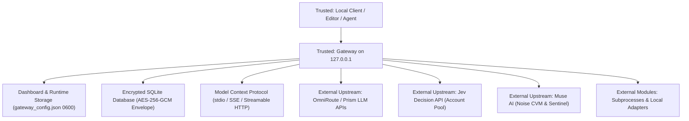

# Security Model

## Intended deployment

`toolcase-gateway` is a loopback sidecar. It is designed to run on the same host as
the client it serves, reachable only over `127.0.0.1`.



**The gateway performs no public authentication and no multi-tenant authorization.** Any process that
can reach the loopback listener can send requests through it, using whatever credentials
the client attaches, the gateway account pools hold, or the upstream already maintains. Binding to a non-loopback
address is therefore an open proxy; the process logs a warning when it detects
this, but does not refuse to start.

If remote access is required, terminate authentication in a front end (nginx,
Caddy, an authenticating proxy, or an SSH tunnel) and let it forward to the
gateway on loopback.

---

## Trust boundaries

| Boundary | Direction | Assumption |
| :--- | :--- | :--- |
| **Client to gateway** | inbound | Client is local and authorized by OS-level access control. Bytes are parsed defensively; malformed heads or oversized bodies are rejected before allocation. |
| **Dashboard to gateway** | inbound | Web UI and REST API run strictly over loopback. Submissions are strictly validated; secrets are masked on read. |
| **MCP client to gateway** | inbound | MCP stdio, SSE, or Streamable HTTP callers are local agents. Commands are strictly validated against tool definitions. |
| **Gateway to persistent storage** | local disk | Persistent JSON (`gateway_config.json`) is stored locally with atomic replacement and POSIX `0600` permissions (owner read/write only). Stored credentials in SQLite are protected via AES-256-GCM envelope encryption and blind indexing. `.env` is never overwritten. |
| **Gateway to Personal Modules** | local subprocess | Out-of-tree plugins execute in isolated child processes with sanitized environments. Parent process keys and cookies are not passed downstream. |
| **Gateway to OmniRoute / Prism** | outbound | Upstream is reachable over HTTP/HTTPS. Status lines dictate model candidate failover before body streaming begins. Responses are re-framed and tool casing is repaired. |
| **Gateway to Jev Decision API** | outbound | Upstream is reachable over HTTPS. Accounts in `JevAccountPool` rotate across requests. Account errors (`401, 402, 403, 429`) trigger silent failover without exposing raw keys. |
| **Gateway to Muse AI (Noise CVM)** | outbound | Upstream WebSocket connection is authenticated via Noise XX handshake with mutual attestation. Inbound frames are bounded and strictly correlated to thread IDs. |
| **Gateway to Muse Sentinel** | outbound | Headless auto-approvals run only when explicitly pre-authorized (`scoped_auto` / `on`). Off-scope or connector requests fail closed. |
| **Upstream to client** | passthrough | Upstream body content is re-framed and casing is restored, but not semantically sanitized. Clients must treat model output as untrusted text. |

---

## Threats and mitigations

### Request smuggling

Conflicting framing lets an attacker desynchronize a proxy chain.

**Mitigation**: `read_request` rejects duplicate `Content-Length` headers, and rejects
`Content-Length` together with `Transfer-Encoding: chunked`, instead of picking a
winner. `parse_headers` rejects names that are not HTTP tokens, which catches the
`X-Bad : 1` and `Transfer-Encoding : chunked` obfuscations that some parsers
accept.

### Header injection and response splitting

A `CR` or `LF` smuggled through a header value can inject a second response.

**Mitigation**: Header values containing `CR`, `LF`, or `NUL` are rejected on both
the request and the response path. The request target must be printable ASCII
excluding `"` and `\`. Upstream reason phrases are stripped of control
characters.

### Memory exhaustion

**Mitigation**: Heads are capped at `MAX_HEAD_BYTES` (64 KB), request bodies at `MAX_REQUEST_BYTES` (64 MB).
Global admission control (`GW_MAX_IN_FLIGHT_REQUEST_BYTES`, default 256 MB) rejects incoming requests
with HTTP 503 before buffering begins when total in-flight bytes exceed limits.
The response rewrite buffer flushes at the last newline, or at 1 MB if the body contains no
newline at all, so a single unbroken stream cannot grow without bound.

### Thread and descriptor exhaustion (slowloris)

**Mitigation**: `GW_MAX_CONNECTIONS` (default 256) caps concurrent connections, and
the check happens before `thread::spawn`, so excess load costs one `503` write
rather than a thread. Every socket carries a read and write timeout
(`GW_IO_TIMEOUT_SECS`, default 120s), so a stalled peer is reclaimed.

### Credential and header leakage

**Mitigation**: Hop-by-hop headers (`Connection`, `Keep-Alive`, `Proxy-Authenticate`,
`Proxy-Authorization`, `TE`, `Trailer`, `Transfer-Encoding`, `Upgrade`) are
stripped in both directions. `Host` is rewritten to the real upstream.
Bodies, authorization tokens, cookies, and headers are never printed to stdout/stderr.

### Response corruption from rewriting

**Mitigation**: The tool-name rewrite only fires on `"name"` keys whose value matches, case
insensitively, a `"name"` value from the request that contained an uppercase
letter. Non-UTF-8 bodies pass through byte-for-byte. Flushing at newline
boundaries prevents a key/value pair from being split across chunks, which would
otherwise let a partial match escape rewriting. A missed rewrite degrades to
"casing not fixed", never to a corrupted body.

Because rewriting changes body length, `Content-Length` and `ETag` are dropped
and the response is re-framed as chunked. Clients must not rely on the upstream
digest matching.

### Compressed bodies

A gzip or brotli body cannot be rewritten without decompressing it, which would
mean pulling in a dependency and buffering.

**Mitigation**: `Accept-Encoding: identity` is forced upstream and any client
`Accept-Encoding` is dropped. `Content-Encoding` is stripped from the response so
a non-compliant upstream cannot mislabel a plaintext body.

### Supply chain and memory safety

**Mitigation**: Zero async runtimes (`tokio` / `async-std` forbidden) and standard library focus.
`#![forbid(unsafe_code)]` is enforced at both the crate level and in
`Cargo.toml` lints, so no `unsafe` block can be introduced.

---

### Dashboard & Persistent Configuration Security Model

The runtime configuration dashboard at `/dashboard` and REST API endpoints
(`GET /api/v1/dashboard/overview`, `POST /api/v1/dashboard/accounts`, `POST /api/v1/dashboard/config`, `POST /api/v1/dashboard/muse-config`) manage live settings and provider account pools:

1. **Credential Masking**: All read responses (`GET /api/v1/dashboard/overview`, `GET /muse-ai/v1/config`) mask API keys, tokens, and cookies. Only the first 6 and last 4 characters are exposed (e.g., `sk-glm...d74b`) or `***` for short secrets. Full plaintext credentials are never returned over read endpoints.
2. **Isolated Persistent Storage (`gateway_config.json`)**: Persistent configuration changes are written to a standalone `gateway_config.json` file. The original `.env` file is left untouched. Updates write to a temporary file (`.gateway_config.json~tmp`) and atomically rename it to the target file.
3. **POSIX File Permissions (`0600`)**: On Unix platforms, `gateway_config.json` and temporary staging files are explicitly created with permissions `0600` (read/write by owner only), preventing non-privileged local users from reading stored API keys.
4. **AES-256-GCM Envelope Encryption & Blind Indexing**: Stored credentials in embedded SQLite are protected using AES-256-GCM authenticated encryption. Searchable queries use deterministic HMAC-SHA256 blind indexing (`derive_blind_index`), preventing raw secret exposure in SQLite tables.
5. **Fail-Closed Validation**: Incoming JSON payloads are strictly validated. Unknown providers, empty key arrays, invalid ports, or malformed URLs immediately return HTTP 400 Bad Request.
6. **Deduplication**: Ingesting existing provider API keys via `POST /api/v1/dashboard/accounts` deduplicates keys in memory to prevent rotation pool bloat.

---

### Jev Decision API Multi-Account Security Model

The Jev Decision API subsystem (`/jev/v1/*`, `/jev-ai/v1/*`) provides automated multi-account rotation and failover:

1. **Account Isolation**: Accounts in `JevAccountPool` are rotated per request using thread-safe atomic counters. If an account encounters billing, authorization, or rate exhaustion (`401, 402, 403, 429`), the gateway transparently retries against the next available account.
2. **Secret Non-Leakage**: Upstream account failure details, balances, and internal credentials are not leaked to the downstream client. If all configured accounts are exhausted, a sanitized error is returned.
3. **Idempotency Protection**: When clients supply an `Idempotency-Key` header, it is preserved and forwarded across candidate retries, preventing duplicate downstream billable executions.

---

### Muse Live Generation & Sentinel Headless Approval Security Model

The Muse AI subsystem (`/muse-ai/v1/*`) interacts with remote Confidential VMs and Sentinel approval brokers:

1. **Default Off (Fail-Closed)**:
   The approval subsystem defaults to `mode = "off"`. In this mode, any pending approval emitted by the Muse platform fails fast as HTTP 409 Conflict (`MuseApprovalRequired`), advising manual browser resolution. Modes are:
   - `off`: No auto-approval; fail-closed.
   - `observe`: Logs pending approvals without issuing write decisions.
   - `scoped_auto` (or `on`): Automatically approves only matching, pre-authorized, server-offered decisions.

2. **Strict Session & Thread Correlation**:
   Approvals must match the active Muse session (`thread_id` or `session_scope_id`) and `vm_id`. Cross-thread, cross-VM, or cross-account approvals are rejected and left pending for user action.

3. **Type and Destination Whitelisting**:
   Only explicitly allowed approval types (`GW_MUSE_APPROVAL_ALLOWED_TYPES`, default `"network"`) are eligible. Connector approvals (such as Google Drive access or permission changes) always require manual authorization, even if `connector` is configured. Sensitive actions (e.g., `outgoing_media`, purchases, messaging, credential access) are rejected by default. An explicit `GW_MUSE_APPROVAL_ALLOWED_DESTINATIONS` allowlist is required; an empty allowlist approves nothing.

4. **Server-Offered Decision Constraint**:
   Decisions must be explicitly offered in `decision_options` by the Muse server. `allow_once` is preferred by default (`prefer_allow_once: true`). Persistent grants (`allow_always: true`) require affirmative opt-in and must be present in the server's options.

5. **Mandatory Post-Decision Verification**:
   The coordinator does not treat HTTP 200/204 or a vanished card as success. It explicitly queries Sentinel (`GET /approvals/{id}`) and verifies `status == "approved"`.

6. **Durable Job State & Idempotency**:
   Video generation tasks write durable records under `.gw_state/video_jobs/` prior to upstream submission. Retries using the same `idempotency_key` / `submission_key` return existing job state rather than submitting duplicate paid generation prompts.

7. **Dynamic Rollback**:
   To immediately disable auto-approval without restarting the process:
   - Submit `POST /api/v1/dashboard/muse-config` with `{"approval_mode": "off"}` via the dashboard or curl.
   - Or set `GW_MUSE_APPROVAL_MODE=off` in `gateway_config.json` / system environment.
   All incoming approvals will immediately fail-closed with HTTP 409 Conflict.

---

## Non-goals

- **Public Internet Gateway**: Designed as a local loopback sidecar. Does not implement public token authentication, tenant billing, or DDoS mitigation.
- **TLS Termination for Downstream Clients**: Downstream clients connect over loopback HTTP/1.1; outbound upstream connections use HTTPS via standard library or blocking client engines.
- **Prompt and Semantic Content Filtering**: Does not inspect or moderate natural language content.
- **General-Purpose Load Balancer**: Multi-account rotation is specifically implemented for provider account limits (e.g. Jev AI credit rotation), not multi-host edge traffic distribution.

---

## Verification

Run the security and framing test suite:

```sh
cargo test                    # framing, header, parsing, and rewrite tests
cargo clippy --all-targets    # lints and contract verification
grep -rn "unsafe" src/        # verify zero unsafe code
```

Key security tests:
- `rejects_conflicting_framing_headers`
- `rejects_header_injection_in_names`
- `rejects_malformed_request_targets`
- `error_body_escapes_message`
- `forces_identity_encoding_upstream`
- `test_atomic_config_persistence_mode_0600`
- `test_mask_key_redaction`
- `test_approval_policy_evaluator`
- `test_secret_encryption_and_decryption_roundtrip`
- `test_sqlite_account_credential_encryption_and_decryption`
- `test_derive_blind_index_deterministic`

---

## Reporting

See [`../SECURITY.md`](../SECURITY.md).
