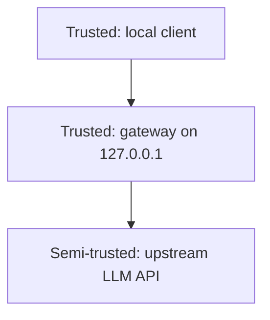

# Security Model

## Intended deployment

`toolcase-gateway` is a loopback sidecar. It is meant to run on the same host as
the client it serves, reachable only over `127.0.0.1`.



**The gateway performs no authentication and no authorization.** Any process that
can reach the listener can send requests through it, using whatever credentials
the client attaches or the upstream already holds. Binding to a non-loopback
address is therefore an open proxy; the process logs a warning when it detects
this, but does not refuse to start.

If remote access is required, terminate authentication in a front end (nginx,
Caddy, an authenticating proxy, or an SSH tunnel) and let it forward to the
gateway on loopback.

## Trust boundaries

| Boundary | Direction | Assumption |
| --- | --- | --- |
| Client to gateway | inbound | Client is local and authorized by OS-level access control. Its bytes are still parsed defensively. |
| Gateway to upstream | outbound | Upstream is reachable but not trusted to send well-formed HTTP. Its headers and body are validated and re-framed. |
| Upstream to client | passthrough | Upstream body content is rewritten but not otherwise sanitized; the client must still treat model output as untrusted. |

## Threats and mitigations

### Request smuggling

Conflicting framing lets an attacker desynchronize a proxy chain.

Mitigation: `read_request` rejects duplicate `Content-Length` headers, and rejects
`Content-Length` together with `Transfer-Encoding: chunked`, instead of picking a
winner. `parse_headers` rejects names that are not HTTP tokens, which catches the
`X-Bad : 1` and `Transfer-Encoding : chunked` obfuscations that some parsers
accept.

### Header injection and response splitting

A `CR` or `LF` smuggled through a header value can inject a second response.

Mitigation: header values containing `CR`, `LF`, or `NUL` are rejected on both
the request and the response path. The request target must be printable ASCII
excluding `"` and `\`. Upstream reason phrases are stripped of control
characters.

### Memory exhaustion

Mitigation: heads are capped at 64 KB, request bodies at 64 MB. The response
rewrite buffer flushes at the last newline, or at 1 MB if the body contains no
newline at all, so a single unbroken stream cannot grow without bound.

### Thread and descriptor exhaustion (slowloris)

Mitigation: `GW_MAX_CONNECTIONS` (default 256) caps concurrent connections, and
the check happens before `thread::spawn`, so excess load costs one `503` write
rather than a thread. Every socket carries a read and write timeout
(`GW_IO_TIMEOUT_SECS`, default 120s), so a stalled peer is reclaimed.

### Credential and header leakage

Mitigation: hop-by-hop headers (`Connection`, `Keep-Alive`, `Proxy-Authenticate`,
`Proxy-Authorization`, `TE`, `Trailer`, `Transfer-Encoding`, `Upgrade`) are
stripped in both directions. `Host` is rewritten to the real upstream. Bodies and
headers are never logged, so bearer tokens and prompts stay out of stderr.

### Response corruption from rewriting

Mitigation: the rewrite only fires on `"name"` keys whose value matches, case
insensitively, a `"name"` value from the request that contained an uppercase
letter. Non-UTF-8 bodies pass through byte-for-byte. Flushing at newline
boundaries prevents a key/value pair from being split across chunks, which would
otherwise let a partial match escape rewriting. A missed rewrite degrades to
"casing not fixed", never to a corrupted body.

Because rewriting changes body length, `Content-Length` and `ETag` are dropped
and the response is re-framed as chunked. Clients must not rely on the upstream
digest matching.

### Compressed bodies

A gzip or brotli body cannot be rewritten without decompressing it, which would
mean pulling in a dependency and buffering.

Mitigation: `Accept-Encoding: identity` is forced upstream and any client
`Accept-Encoding` is dropped. `Content-Encoding` is stripped from the response so
a non-compliant upstream cannot mislabel a plaintext body.

### Supply chain

Mitigation: zero third-party dependencies. `Cargo.lock` contains only this
package. `#![forbid(unsafe_code)]` is enforced at both the crate level and in
`Cargo.toml` lints, so no `unsafe` block can be introduced.

### Muse live generation and capture handling

Muse capture files are private, untrusted input. The configuration UI at `/muse-config` and `GET /muse-ai/v1/config` return currently effective non-secret settings and masked indicators for secrets (`access_token`, `notary_token`, `cookie`). Unmasked credentials, raw HAR contents, or signed connection URLs are never exposed in read responses. Live HAR imports via `POST /muse-ai/v1/config/har` update memory immediately and persist unmasked pairs to disk with mode `0600`. The opt-in capture tests send
cookies only to the fixed `https://muse.ai` authentication/session endpoints,
use a limited browser-header allowlist, disable HTTP redirects, and refresh the
access token. Site cookies are not forwarded to the separate Noise VM host.
Captured thread actions are not replayed: HTTP 2xx alone does not prove thread
creation, and the observed action returned UI bootstrap data instead.

Fresh chat requests use a new draft identity and validate the returned isolated
thread acknowledgement. The gateway subscribes to that acknowledged session,
parses bounded newline-delimited JSON across frame boundaries, and excludes
user echoes and explicitly different sessions from assistant output. Pending
approvals are matched to the requested session; by default (`GW_MUSE_APPROVAL_MODE=off`),
an applicable Muse permission prompt fails fast as HTTP 409 Conflict
(`MuseApprovalRequired`) on `POST /muse-ai/v1/create-video`. An acknowledgement,
partial text, timeout, or reset is not successful completion.

After WebSocket connection, Noise reads and writes share a 360-second operation
deadline, of which the final 300 seconds are reserved for a bounded wait for a
delayed `delta.presentation` video artifact. Live commands also require an
external timeout to bound connection setup. Live failures suppress private
response content and credential-bearing URLs; debug output reports allowlisted
event categories rather than raw frames.

### Dashboard & Provider Multi-Account Ingestion Security Model

The provider management dashboard at `/gateway-config/dashboard` and API endpoints (`GET /api/v1/dashboard/overview`, `POST /api/v1/dashboard/accounts`) manage runtime credentials and provider pools:

1. **Credential Masking**: All read responses and overview displays mask API keys and secrets. Only the prefix and suffix (`sk-glm...d74b`) or redaction tokens (`***`) are exposed. Full plaintext keys are never returned in read responses.
2. **Safe Persistence**: Key persistence writes updated `.env` configuration files using atomic replacement with restricted file permissions (`0600` on Unix), preventing credential theft or file corruption during process termination.
3. **Fail-Closed Validation**: Account ingestion validates payload format, rejects unsupported providers or empty credentials with HTTP 400 Bad Request, and enforces HTTP 405 Method Not Allowed on invalid methods.
4. **Duplicate Deduplication**: Resubmitting existing keys avoids credential duplication in the memory rotation pool.

### Muse Sentinel Headless Approval Security Model

The headless Muse Sentinel auto-approval coordinator allows automated resolution of pre-authorized, scoped approvals during video generation without browser automation:

1. **Default Off (Fail-Closed)**:
   The approval subsystem defaults to `mode = "off"`. In this mode, any pending approval immediately yields HTTP 409 Conflict (`MuseApprovalRequired`), advising manual browser approval. Modes are:
   - `off`: No auto-approval; fail-closed.
   - `observe`: Logs pending approvals without issuing write decisions.
   - `scoped_auto` (or `on`): Auto-approves only matching, pre-authorized, server-offered decisions.

2. **Strict Scope and Session Correlation**:
   Approvals must match the active Muse session (`thread_id` or `session_scope_id`) and `vm_id`. Cross-thread, cross-VM, or cross-account approvals are rejected and left pending for user action.

3. **Type and Destination Whitelisting**:
   Only explicitly allowed non-connector approval types (`GW_MUSE_APPROVAL_ALLOWED_TYPES`, default `"network"`) are eligible. Connector approvals always require manual authorization, including Google Drive permission changes and public sharing, even if `connector` and `google_drive` appear in the configured allowlists. Sensitive actions (e.g., `outgoing_media`, purchases, messaging, credential access) are rejected by default. An explicit `GW_MUSE_APPROVAL_ALLOWED_DESTINATIONS` allowlist is required; an empty allowlist approves nothing.

4. **Server-Offered Decision Constraint**:
   Decisions must be explicitly offered in `decision_options` by the Muse server. `allow_once` is preferred by default (`GW_MUSE_APPROVAL_PREFER_ALLOW_ONCE=true`). Persistent grants (`allow_always`) require an affirmative opt-in (`GW_MUSE_APPROVAL_ALLOW_ALWAYS=true`) and must be present in the server's options.

5. **Mandatory Post-Decision Verification**:
   The coordinator does not treat HTTP 200/204 or a vanished card as success. It explicitly reads the approval status from Sentinel (`GET /approvals/{id}`) and requires `status == "approved"`.

6. **Idempotency and Anti-Duplication**:
   Video generation tasks write durable state in `.gw_state/video_jobs/` prior to upstream submission. Retries using the same `idempotency_key` / `submission_key` return existing job state rather than submitting duplicate paid generation prompts.

7. **Rollback Instructions**:
   To immediately disable auto-approval without service disruption:
   - Set `GW_MUSE_APPROVAL_MODE=off` in `.env` or system environment.
   - Restart the gateway process. All pending or incoming approvals will immediately fail-closed and return HTTP 409 for manual user resolution. Existing job records and history are preserved.

Normal tests do not contact Muse. Run individual live tests explicitly:

```sh
# Read-only authentication/session verification:
MUSE_LIVE_TEST=1 cargo test test_live_muse_auth_from_har_capture -- --nocapture
# Generates a new video request and can consume credits:
MUSE_LIVE_TEST=1 cargo test test_live_create_video_from_har_capture -- --nocapture
# Read-only subscription to the session previously created by the generation test:
MUSE_LIVE_RESUME_OWNED=1 cargo test test_live_muse_owned_session_events -- --nocapture
```

Use a command-runner timeout of 420 seconds for generation or owned-session
commands and 210 seconds for authentication-only checks. Do not set the live
opt-in globally when running the entire test suite. The generation test
stores its acknowledged session in `target/muse-live-owned-session.json` and
refuses to generate again while that file exists. The read-only follow-up does
not create another task, approve permissions, or delete threads. Review any
permission prompt in Muse itself. Archive the owned-session file privately
before deliberately starting a different generation.

On Unix, successful live video results are created exclusively with mode `0600`
at `target/muse-video-result.json`; only that path is printed. These tests do not
overwrite existing artifacts. Non-Unix platforms fail closed for private result
storage until owner-only ACL support is implemented. A failed live test must not
be reported as video generation verified.

## Non-goals

- TLS termination. Run the gateway on loopback and let the upstream client handle
  TLS to the remote API.
- Authentication, rate limiting, or per-tenant quotas.
- Prompt or output filtering. The gateway does not inspect semantic content.
- Multi-host routing or load balancing across upstream endpoints.

## Verification

```sh
cargo test                    # framing, header, and rewrite tests
cargo clippy --all-targets
grep -rn "unsafe" src/        # only the forbid attribute
```

Tests covering the hardening above: `rejects_conflicting_framing_headers`,
`rejects_header_injection_in_names`, `rejects_malformed_request_targets`,
`error_body_escapes_message`, `forces_identity_encoding_upstream`.

## Reporting

See [`../SECURITY.md`](../SECURITY.md).
