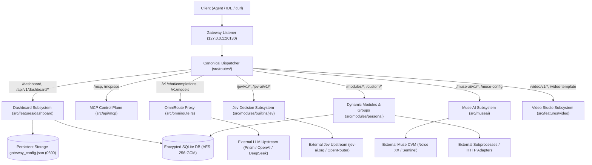
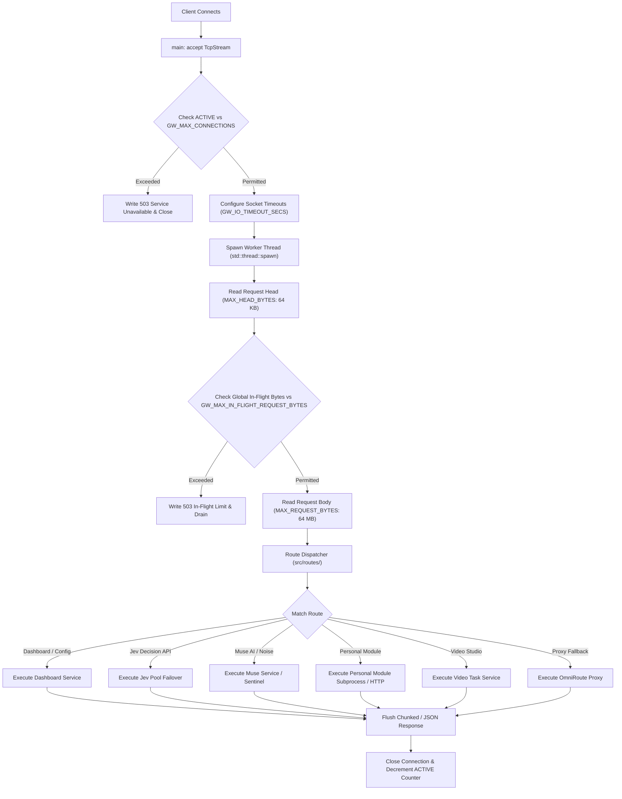
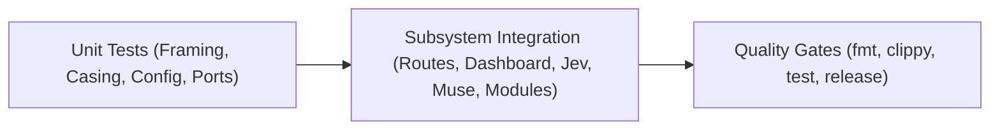

# System Design

This document describes the runtime architecture, code ownership, concurrency model, and data flow of `toolcase-gateway`.
Use this document as an authoritative architectural map before modifying code.

---

## 1. System Overview

`toolcase-gateway` is a high-performance, zero-async, local Rust reverse proxy and sidecar gateway designed to run alongside local clients (IDEs, agent runners, developer tooling).

It orchestrates six primary subsystems:

### Primary Subsystems
1. **OmniRoute Proxy**: OpenAI-compatible `/v1/chat/completions` proxy providing transparent model candidate failover, request-response tool-name casing restoration, and stream chunking without buffering entire response bodies.
2. **Jev Decision API**: Multi-account round-robin pool (`JevAccountPool`) and automatic failover on credit exhaustion or auth errors (`401, 402, 403, 429`) routing specialized decision payloads (`/jev/v1/systemone`) and OpenRouter decision tiers.
3. **Muse AI Subsystem**: End-to-end encrypted Noise XX WebSocket transport communicating directly with remote Confidential VMs (CVM), conversational chat continuity, video generation (`/muse-ai/v1/create-video`), image synthesis (`/muse-ai/v1/create-image`), and headless Sentinel auto-approval coordinator.
4. **Interactive Dashboard & Standalone Persistent Storage**: Embedded web UI at `/dashboard` and REST endpoints at `/api/v1/dashboard/*` providing real-time overview, provider account ingestion, PWA support, and atomic POSIX `0600` persistence to `gateway_config.json`.
5. **Model Context Protocol (MCP) Control Plane**: Native MCP server engine implementing stdio, SSE (`/mcp/sse`), and Streamable HTTP (`/mcp`) transports for autonomous AI engineering environments.
6. **Dynamic Modules & Plugin Architecture**: Modular self-contained personal modules, declarative manifests, GitHub/ZIP remote installation, and prefix-isolated URL namespaces.
7. **Encrypted Storage Subsystem**: Embedded SQLite engine (`rusqlite`) utilizing hardware-accelerated AES-256-GCM envelope encryption and blind indexing for credential and module state storage.

---

## 2. Architectural Invariants

Every change to the codebase must maintain these foundational invariants:

1. **Zero Async**: Strictly no async runtimes (`tokio`, `async-std`, etc.). All networking uses standard library blocking sockets (`std::net::TcpStream`, `std::net::TcpListener`), threads (`std::thread`), and blocking HTTP client engines (`ureq`).
2. **Memory Safety**: `#![forbid(unsafe_code)]` is enforced at crate root and compiler lints. No `unsafe` blocks are permitted anywhere in the repository.
3. **File Size Ceilings**:
   - **Target**: Under **450 lines** per file.
   - **Soft Ceiling**: **800 lines** maximum. Files approaching 800 lines must be partitioned into cohesive submodules following Clean Architecture and Domain-Driven Design (DDD).
4. **Fail-Closed Canonical Routing**: Route matching is centralized exclusively in `src/routes/`. Unknown routes or invalid HTTP methods fail closed immediately (HTTP 404 or 405) with JSON error envelopes.
5. **Subsystem Facade Encapsulation**: Domain modules are encapsulated behind module facades (`pub(crate) use` in `mod.rs`), preserving stable internal contracts and backward-compatible entry points (e.g. `src/museai/mod.rs` and `src/jev/mod.rs`).
6. **Isolated Persistent Configuration**: User configuration updates are persisted to `gateway_config.json` via atomic rename and restricted permissions (`0600`) and to encrypted SQLite. The startup `.env` file is never rewritten or corrupted.
7. **Continuous Supply-Chain Verification**: Dependabot actively tracks Cargo dependencies and GitHub Actions workflows, resolving all published advisories.

---

## 3. Runtime Lifecycle & Concurrency

### Connection Lifecycle

### Concurrency Model
- **Worker-per-Connection**: Each incoming TCP connection is dispatched to an isolated OS thread.
- **Active Tracker**: An atomic counter (`ACTIVE: AtomicUsize`) gates concurrent connections before worker allocation.
- **Dynamic Configuration (`ConfigStore`)**: Configuration is managed via `ConfigStore` wrapped in a reader-writer lock (`RwLock<Config>`). Workers take lightweight read snapshots (`store.snapshot()`) without blocking other connections. Updates write to memory and immediately sync to `gateway_config.json`.
- **Thread-Safe Account Pools**: `JevAccountPool` uses atomic round-robin counters (`AtomicUsize`) to cycle through available API keys across concurrent requests.

---

## 4. Components and Code Ownership

Runtime code is cleanly separated into focused modules under `src/` honoring Clean Architecture and Domain-Driven Design (DDD) rules:

| Directory / File | Lines Target | Architectural Responsibility | When to modify |
| :--- | :--- | :--- | :--- |
| `src/main.rs` | <150 | CLI entry point, signal handling, TCP listener loop, admission bounds, `--mcp` entry | Modifying process startup or listen loop |
| `src/lib.rs` | <180 | Crate entry point, library facade re-exports, bootstrap | Exposing crate-level library APIs |
| `src/routes/` | <450/mod | Modular fail-closed route dispatchers (`dashboard`, `jev`, `modules`, `muse`, `templates`) | Adding or modifying any API or route path |
| `src/config/` | <450/mod | Modular config (`types`, `store`, `persistent`, `env`), atomic `0600` JSON persistence | Adding configuration fields or storage rules |
| `src/api/mcp/` | <450/mod | Native MCP server engine: stdio, SSE (`/mcp/sse`), and Streamable HTTP (`/mcp`) | Extending Model Context Protocol capabilities |
| `src/storage/` | <450/mod | SQLite database (`rusqlite`), AES-256-GCM envelope encryption, blind indexing | Modifying encrypted credential or module storage |
| `src/modules/` | <450/mod | Clean Architecture modular system: built-in providers (`jev`, `museai`), personal plugins, catalog | Adding or modifying provider modules |
| `src/http.rs` | <400 | HTTP/1.1 framing parser, header validation, chunked encoding, error writer | Changing HTTP syntax rules or size limits |
| `src/omniroute.rs` | <400 | OmniRoute fallback candidate runner, streaming proxy, response writer | Modifying model failover or stream piping |
| `src/rewrite.rs` | <250 | Pure stream transformations, tool-name casing restoration, JSON string parsing | Tuning tool casing repair logic |
| `src/har_config.rs` | <800 | HAR capture extraction, cookie/token parsing, credential validation | Updating HAR import parsing algorithms |
| `src/video_template.rs` | <350 | Embedded HTML asset delivery (`/video-template`, `/image-template`, `/muse-config`) | Modifying static template delivery |
| `src/runtime/` | <450/mod | Admission controller (`admission.rs`), multi-stream logger with ZIP compression (`logger/`) | Tuning memory bounds or log retention |
| `src/gateway/` | <450/mod | Candidate selection, retry policies, module installer (`installer.rs`, `archive.rs`) | Changing retry timings or module packaging |
| `src/codecs/` | <150 | SSE parser and chunk framing | Modifying SSE wire format decoding |
| `src/features/dashboard/` | <450/mod | Dashboard UI, overview endpoint, account ingestion, config updates, PWA handlers | Adding dashboard fields or provider UI features |
| `src/features/mcp/` | <450/mod | MCP tool implementations (`gateway_list_modules`, metrics) and resource registries | Adding agentic MCP tools |
| `src/features/proxy/` | <450/mod | Upstream proxy forwarding, prefix rewriting for PWA service workers | Modifying core proxy forwarding primitives |
| `src/museai/` | <450/mod | Muse AI subsystem: Noise XX transport, Sentinel auto-approvals, chat & video services | Modifying Muse CVM communication or Sentinel policies |

---

## 5. Subsystem Details

### 5.1 OmniRoute Upstream Proxy (`src/omniroute.rs`)

Designed for OpenAI-compatible `/v1/chat/completions` endpoints:

1. **Request Buffering**: Request head and body are buffered in memory to allow inspection of the requested `"model"` and tool definitions.
2. **Candidate Generation**:
   - Primary: Model specified in request JSON.
   - Secondary: Configured `fallbacks` (from `GW_FALLBACK_MODELS`), rotated per request.
3. **Pre-Commit Failover**: Upstream connection opens and reads only the HTTP status line. If upstream returns a retryable status (`400, 401, 402, 403, 408, 429, 500, 502, 503, 504, 524`), the gateway transparently connects to the next candidate model.
4. **On-the-Fly Tool Casing Repair**: Once committed, the response body streams to the client in chunked encoding. A newline-delimited buffer inspects tool names and restores original casing (`mytool` -> `MyTool`) from the client request.

### 5.2 Jev Decision Subsystem (`src/providers/jev/`)

Jev is an asynchronous decision classification service, not a conversational token streamer:

1. **Dedicated Routes**: Centralized at `/jev/v1/systemone` (decision classification), `/jev/v1/models` (catalog), `/jev/v1/requests/{id}` (status), and `/jev/v1/requests/{id}/cancel` (cancellation).
2. **Account Pool Rotation (`JevAccountPool`)**: Multiple API keys configured via `GW_JEV_API_KEYS` or dynamic dashboard ingestion are held in a pool. Requests cycle through accounts in round-robin order.
3. **Credit & Auth Failover**: If an account returns `401 Unauthorized`, `402 Payment Required`, `403 Forbidden`, or `429 Too Many Requests`, the gateway automatically retries using the next candidate account in the pool.
4. **Idempotency Forwarding**: Inbound `Idempotency-Key` headers are forwarded upstream across failovers to guarantee safe retries.

### 5.3 Muse AI Subsystem (`src/providers/museai/`)

Communicates directly with Muse Confidential VMs (CVM):

1. **Cryptographic Handshake**: Uses `Noise_XX_25519_AESGCM_SHA256` over WebSockets. Performs mutual attestation using notary tokens and ephemeral Curve25519 keys.
2. **Video Generation (`POST /muse-ai/v1/create-video`)**: Generates video tasks by orchestrating isolated chat sessions, polling presentation artifacts, and validating public HTTPS video URLs.
3. **Durable State**: Job state is recorded under `.gw_state/video_jobs/{id}.json` with revision histories and idempotency tracking.
4. **Headless Sentinel Auto-Approval Coordinator**: Automatically intercepts and evaluates permission prompts emitted during generation. Evaluates pre-authorized rules (`GW_MUSE_APPROVAL_MODE=on`, destination and type allowlists) and issues cryptographically valid approvals without requiring user browser intervention.

### 5.4 Interactive Dashboard Subsystem (`src/features/dashboard/`)

Provides operator management without editing raw configuration files:

1. **Web Interface (`/dashboard`)**: Embedded lightweight HTML/CSS/JS dashboard displaying provider status, account pools, and settings.
2. **REST Endpoints**:
   - `GET /api/v1/dashboard/overview`: Returns operational status, provider account summaries, and masked credentials.
   - `POST /api/v1/dashboard/accounts`: Dynamically adds provider API keys into active rotation pools.
   - `POST /api/v1/dashboard/config`: Updates gateway target host, port, fallbacks, default model, and timeouts.
   - `POST /api/v1/dashboard/muse-config`: Updates Muse credentials, VM ID, approval policies, and video prompt defaults.
3. **Atomic Persistence**: Serializes updates into `gateway_config.json` via temporary file writing, POSIX `0600` permission assignment, and atomic replacement.

---

## 6. Testing Strategy

The codebase enforces strict test verification across all layers:

- **Gateway Tests** (`tests/gateway.rs`): Request framing, HTTP validation, header injection prevention, response chunking.
- **Dashboard Tests** (`tests/dashboard.rs`): Storage persistence, POSIX `0600` permissions, key masking, dynamic updates.
- **Jev Tests** (`tests/jev.rs`): Route mapping, multi-account rotation, failover mechanics, idempotency.
- **Muse Tests** (`tests/muse.rs`): Protocol framing, Noise XX handshakes, Sentinel approval policies, job lifecycle.
- **Route Contracts** (`tests/routes_contract.rs`): Enforces fail-closed routing and HTTP method correctness across all endpoints.
