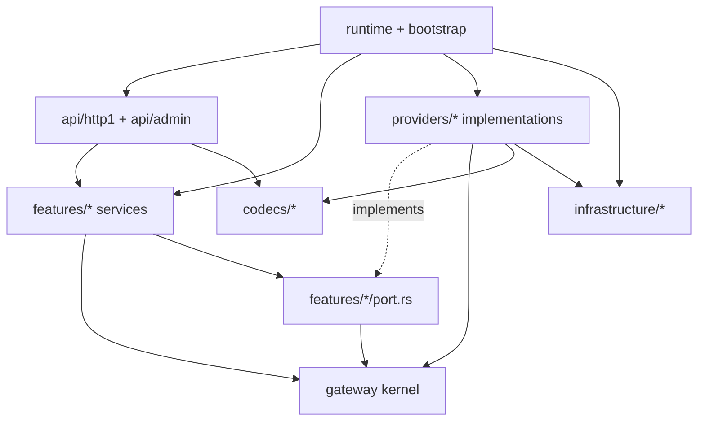

# Toolcase Gateway — Rust Architecture V4

**Status:** Architecture proposal; not merged or compiled.  
**Date:** 2026-10-11  
**Goal:** Improve maintainability, provider extensibility, bounded streaming, and correct retry/security behavior without a big-bang rewrite.

## 0. Confidence and evidence

This design was checked against the public GitHub **README**, **Cargo.toml**, **docs/ARCHITECTURE.md**, **docs/SYSTEM_DESIGN.md**, and **AGENTS.md** on 2026-10-11, plus the existing V2/V3 design artifacts. The complete latest `src/` tree and all source bodies could **not** be fetched in this environment; the repository source-level mapping is therefore a migration hypothesis that needs confirmation against a local checkout. Do not claim a full source audit or successful compilation.

Verified repository facts:
- Single Cargo package with `src/main.rs` and `src/lib.rs`; edition 2021, `rust-version = "1.74"`.
- `Cargo.toml` has `dotenvy`, `serde`, `serde_json`, `ureq` v3, `uuid`, `snow`, `tungstenite`; the 'zero dependency' project description is stale.
- Documented feature routes cover generic OmniRoute fallback, Prism, Jev, Muse chat/catalog/video, and privileged HAR configuration.
- `src/museai` is already decomposed into chat, video, handlers, session, transport, protocol, noise, business, and thread lifecycle modules.
- `AGENTS.md` requires a plan in `plan/pending/` before an implementation change and has a target file-size ceiling of 450 lines and a soft ceiling of 800 lines.
- Current docs contradict one another on whether the application is a small std-only model-fallback proxy or a multiprovider gateway. Treat docs as useful maps, not verified code behavior.

## 1. Architectural thesis

**Capability-oriented Modular Monolith, with a small shared gateway kernel and provider-specific adapters.**

- **One package, one binary** to begin with; a Cargo workspace is a future option, not a starting requirement.
- **Two deliberately distinct paths:** (1) `transparent proxy` that preserves unknown endpoints/payload fields and performs only explicitly configured bounded transformations; (2) `capability endpoints` with typed contracts for chat, models, or video.
- **Feature-first application code** (`features/chat`, `features/models`, `features/video`, `features/proxy`) rather than one global `services/` dumping ground.
- **Provider-first integrations** (`providers/jev`, `providers/museai`, etc.) with their own auth, protocol, mapping and account state.
- **Shared kernel only for proven invariants:** request/attempt metadata, eligibility, provider identity/capabilities, routing, retry safety and error classification.
- **Technology adapters separate from business logic:** inbound HTTP1, SSE decoder, outbound HTTP/WebSocket, secrets and telemetry.
- **Synchronous runtime remains valid**; revise it only after measuring throughput, heap, connection starvation and cancellation behavior.

## 2. Canonical target layout

`(optional)` means *do not create this file/folder until the corresponding responsibility exists*. The tree is a destination map, not a command to create empty files.

```text
toolcase-gateway/
├── Cargo.toml
├── Cargo.lock
├── AGENTS.md                 # preserve existing repository rules
├── src/
│   ├── main.rs              # tiny binary entry; calls bootstrap
│   ├── lib.rs               # module declarations and deliberately small public API
│   ├── bootstrap.rs         # composition root; construct shared state, bind, shutdown
│   │
│   ├── api/                 # inbound adapters; HTTP-facing only
│   │   ├── mod.rs
│   │   ├── router.rs         # method/path/owner/privilege registry; no provider IO
│   │   ├── http1/
│   │   │   ├── mod.rs
│   │   │   ├── framing.rs    # request framing and smuggling protections
│   │   │   ├── request.rs    # parse and boundary validation
│   │   │   ├── response.rs   # response headers, commit state, errors
│   │   │   └── server.rs     # accepted connection execution
│   │   └── admin/
│   │       ├── mod.rs
│   │       ├── routes.rs
│   │       ├── auth.rs       # authorization, Origin/CSRF checks
│   │       └── har.rs        # sanitize + validate imported credentials
│   │
│   ├── features/            # application use cases and feature-owned logic
│   │   ├── mod.rs
│   │   ├── proxy/
│   │   │   ├── mod.rs
│   │   │   ├── service.rs    # unknown-path transparent relay + legacy fallback
│   │   │   └── rewrite.rs    # only bounded transformations allowed on proxy path
│   │   ├── chat/
│   │   │   ├── mod.rs
│   │   │   ├── service.rs    # chat use case orchestration
│   │   │   ├── port.rs       # narrow capability trait for chat
│   │   │   ├── types.rs      # chat-domain types (NOT every wire field)
│   │   │   └── tool_names.rs # casing correction specific to tool calls
│   │   ├── models/
│   │   │   ├── mod.rs
│   │   │   ├── service.rs
│   │   │   └── port.rs       # listing/catalog capability
│   │   └── video/            # (optional) only if video becomes gateway use case
│   │       ├── mod.rs
│   │       ├── service.rs
│   │       └── port.rs       # submit/status/cancel are separate operations
│   │
│   ├── gateway/             # small transport-neutral coordination kernel
│   │   ├── mod.rs
│   │   ├── context.rs        # request id, deadline, config generation, intent
│   │   ├── provider.rs       # ProviderId, OperationKind, Capabilities
│   │   ├── candidates.rs     # pure candidate plans, compatibility checks
│   │   ├── retry.rs          # replay/delivery/commit-aware retry decisions
│   │   ├── attempt.rs        # attempt outcome and lifecycle transitions
│   │   └── error.rs          # stable internal error categories
│   │
│   ├── providers/           # external AI systems; implementations, not policy owner
│   │   ├── mod.rs
│   │   ├── omniroute/
│   │   │   ├── mod.rs
│   │   │   └── adapter.rs
│   │   ├── prism/
│   │   │   ├── mod.rs
│   │   │   └── adapter.rs
│   │   ├── jev/
│   │   │   ├── mod.rs
│   │   │   ├── adapter.rs
│   │   │   └── accounts.rs  # Jev-owned account rotation/cooldown
│   │   └── museai/
│   │       ├── mod.rs
│   │       ├── chat.rs
│   │       ├── video.rs
│   │       ├── session.rs
│   │       ├── threads.rs
│   │       ├── protocol.rs
│   │       ├── noise.rs
│   │       ├── transport.rs
│   │       └── handlers.rs  # temporary facade during migration only
│   │
│   ├── codecs/              # shared *wire-format* processing, no routing logic
│   │   ├── mod.rs
│   │   ├── sse.rs            # event framing, UTF-8, multiline data, limits
│   │   └── openai.rs         # (optional) shared OpenAI wire DTO/codec
│   │
│   ├── infrastructure/       # outbound platform mechanisms
│   │   ├── mod.rs
│   │   ├── http_client.rs    # ureq, timeout, host policy, outbound headers
│   │   ├── websocket.rs     # tungstenite and connection lifecycle
│   │   ├── secrets.rs       # redacted wrappers + credential resolution
│   │   └── telemetry.rs     # structured events / metrics, sanitized
│   │
│   └── runtime/              # *process-scoped* state and lifecycle
│       ├── mod.rs
│       ├── state.rs          # AppState, shared registry, stable handles
│       ├── config.rs         # validated immutable snapshot/reload
│       ├── providers.rs      # bind provider implementations to capabilities
│       └── admission.rs      # connection + in-flight-byte RAII guards
│
├── tests/
│   ├── routes_contract.rs
│   ├── proxy_compat.rs
│   ├── providers_contract.rs
│   ├── retry_commit.rs
│   ├── stream_golden.rs
│   ├── admin_security.rs
│   └── fixtures/            # redacted synthetic payloads
├── docs/
│   ├── architecture/        # proposed new canonical reference location
│   │   ├── V4.md
│   │   ├── PLACEMENT_RULES.md
│   │   └── ADR-0002-capability-modules.md
│   └── ...                  # existing docs retained with superseded banners
└── plan/
    └── pending/             # AGENTS.md implementation-plan contract
```

**No root-level `common/`, `shared/`, `helpers/`, `utils/` or all-purpose `services/`.** Shared implementation goes where its *contract and semantics* belong, never merely where it is used twice.

## 3. Dependency direction



**Enforce these rules:**
1. `gateway` must NOT import `api`, `features`, `providers`, `runtime`, `infrastructure`, `TcpStream`, `ureq` or `tungstenite`.
2. `features` may import `gateway` and its own capability ports; must NOT import concrete provider implementations or `std::net::TcpStream`.
3. `providers` implement capability contracts, own upstream authentication and protocol quirks, and may import `gateway`, `codecs`, `infrastructure`.
4. `api` owns route dispatch, client socket framing, HTTP errors and downstream commit; it delegates to `features` or the transparent proxy use case.
5. `runtime`/`bootstrap` is allowed to depend on all adapters to wire the program; feature code must not depend on the composition root.
6. `codecs` parse/serialize formats only, not select providers or read secrets.
7. Avoid cycles. `pub(crate)` is not architectural isolation on its own: enforce reviews plus lightweight import checks and integration tests.

## 4. Where shared logic and services go

| New code | Place it in | Reason |
|---|---|---|
| Generic retry eligibility and budget | `gateway/retry.rs` | transport-neutral policy shared across operations, using explicit replay-safety metadata |
| Model-candidate ordering and capability check | `gateway/candidates.rs` | deterministic global routing decision |
| Orchestrate a chat request | `features/chat/service.rs` | feature-specific use case, not a global service container |
| Rename case-drifted tool calls in OpenAI chat | `features/chat/tool_names.rs` | chat semantics, not a generic byte utility |
| Decode SSE events safely | `codecs/sse.rs` | stable wire-format parser, independent of provider |
| Translate Jev JSON to/from chat contract | `providers/jev/adapter.rs` (or `mapper.rs` when large) | Jev-specific behavior |
| Jev account rotation/cooldown | `providers/jev/accounts.rs` | one-provider ownership; held as long-lived process state |
| Shared outbound TLS/HTTP behaviors | `infrastructure/http_client.rs` | network technology, not business rule |
| Muse Noise framing | `providers/museai/protocol.rs` and `noise.rs` | protocol is NOT shared merely because it is a protocol |
| Configuration snapshots/atomic reload | `runtime/config.rs` | runtime lifetime and consistency |
| Admin HAR validation and audit | `api/admin/har.rs` | privileged control plane boundary |
| Small encoding/string function used once | private helper next to caller | the most maintainable helper is the one closest to its owner |
| Shared value object used by distinct features | `gateway/` ONLY if semantics identical; otherwise duplicate small structs | avoiding the 'god types' anti-pattern |

For a helper that is duplicated in two providers, first ask **whether its failure modes, auth policy and protocol semantics are identical**. If yes, extract to `codecs` or `infrastructure`; if not, preserve local variants.

## 5. Non-negotiable gateway contracts

### 5.1 Explicit protocol modes
- `ProxyMode::Transparent`: arbitrary supported HTTP method/path and raw body; no indiscriminate deserialization or normalization; preserve compatibility.
- `ProxyMode::Adapted`: OpenAI-style chat/model/video operations with a parsed/validated minimal contract.
- No silent route fallthrough from a claimed namespace (`/muse-ai`, `/prism-openai`, `/jev*`) into generic proxy.
- Avoid a single universal `GatewayRequest` containing every possible LLM API shape.

### 5.2 Attempt and commit state
- Plan candidate order and effective deadline before sending the first attempt.
- Track `NotStarted`, `Prepared`, `PossiblySent`, `ReceivedHeaders`, `DownstreamCommitted`, `Completed` as **logical milestones**, not a forced shared mutable state machine implementation.
- Retry requires: eligible error + candidates/budget remaining + replay permitted + no downstream commit + acceptable upstream delivery uncertainty.
- HTTP status codes alone are not retry authorization. `400` should not be globally retried by default; provider-specific classification plus policy is required.
- Video creation and cleanup are side-effecting: no blind retries after uncertain submission. Idempotency keys only where supported and actually propagated.

### 5.3 Streaming
- Distinguish HTTP/1.1 framing from SSE event framing and from JSON event transformations.
- SSE may use LF, CRLF or CR line endings, comments and multi-line `data:` fields; TCP read boundaries are not event boundaries.
- Never emit rewritten partial semantic events. Enforce record-size limits and define fail-closed or pass-through behavior for oversized events.
- Downstream writer owns commit state and backpressure; after headers/body begin, cannot switch provider and silently restart output.
- Keep prompt and response bytes out of default logs.

### 5.4 State and security
- Build provider registry and Jev account pool **once per process** and inject handles; do not rebuild rotation state on each request.
- Each request clones one `Arc<ValidatedConfig>` snapshot, no live mutable config exposure over network callbacks.
- Limit both number of connections and total in-flight memory/bytes; request body max and connection max by themselves do not cap total heap affordably.
- Dedicated privileged admin authorization + Origin/CSRF policy, and atomic/sanitized credential update; no accidental public exposure.
- Preserve loopback-default and `unsafe_code = forbid`. Keep project MSRV at 1.74 unless a reviewed compatibility change is chosen; check current dependency MSRVs explicitly.

## 6. Traits, Rust idioms, and avoiding overengineering

Define **capability-specific traits** only when they create actual substitution and testing seams, not one `Provider` trait with dozens of optional methods. Example (illustrative, not drop-in):

```rust
pub trait ChatCompletionPort: Send + Sync {
    fn execute(&self, input: &ChatAttempt) -> Result<ChatOutcome, ProviderError>;
}

pub trait ModelCatalogPort: Send + Sync {
    fn list(&self) -> Result<Vec<ModelInfo>, ProviderError>;
}
```

`ChatAttempt`, `ChatOutcome`, `ProviderError` must be defined in appropriate feature/kernel modules and must NOT contain inbound sockets or provider credentials. A separate video port should distinguish submit/status/cancel and idempotency. Streaming needs an explicit borrowed sink/stream or callback boundary with downstream commitment managed by `api`, not an assumed `Vec<u8>`.

Default helper visibility should be private, `pub(super)` where natural, `pub(crate)` for cross-module APIs, and `pub` only for a stable public library surface. Minimize `Arc<Mutex<_>>`; separate atomic counters from immutable config, and never hold locks over outbound I/O. Prefer typed errors and named structs over tuple/stringly-typed maps. Do not create a framework container or DI macro to wire 3 providers.

## 7. Runtime scaling decision

| Axis | First implementation | When to reevaluate |
|---|---|---|
| Execution | bounded std threads and blocking I/O | connection pressure/p99, memory/stack and slow-stream load tests |
| Deployment | one binary/one process | need independent deployment or blast-radius control |
| Provider state | per-process account pool | multiple instances require coordinated quotas/cooldowns/account leases |
| Configuration | immutable Arc snapshots | high-frequency reloads or distributed config synchronization |
| Storage | no new DB by default | durable asynchronous video jobs, history, rate limits, or distributed state |
| Crates | one Cargo package | genuinely independent release or dependency boundaries; then `crates/` workspace |

Do **not** advertise async or multi-instance scale just from folder organization. Scaling is a measured runtime/state problem.

## 8. Acceptance criteria

- New OpenAI-compatible provider can be added without editing inbound HTTP framing or chat semantics.
- Muse-specific WebSocket/Noise logic stays in the Muse adapter.
- Unknown-route transparent proxy behavior and public API response shapes remain compatible.
- Generic retry policy cannot retry after downstream commitment and cannot replay unsafe video submission under uncertain delivery.
- Jev pool rotation and account availability retain state across requests.
- Fixture tests cover LF/CRLF SSE, chunk splits, multi-line data and casing correction; parser rejects invalid HTTP framing.
- Shared code has a single owner, no generic utility/service junk drawers or provider-specific imports in `gateway/`.
- Configuration update is secure, transaction-like, redacted and does not mutate in-flight snapshots.
- `cargo fmt --all -- --check`, `cargo test`, `cargo clippy --all-targets -- -D warnings`, `cargo build --release` pass in a real Rust checkout.

## 9. Sources

- Current project: https://github.com/giauphan/toolcase-gateway
- Cargo manifest: https://github.com/giauphan/toolcase-gateway/blob/main/Cargo.toml
- Current docs: https://github.com/giauphan/toolcase-gateway/blob/main/docs/ARCHITECTURE.md
- Stale/older map: https://github.com/giauphan/toolcase-gateway/blob/main/docs/SYSTEM_DESIGN.md
- Agent constraints: https://github.com/giauphan/toolcase-gateway/blob/main/AGENTS.md
- Rust API Guidelines: https://rust-lang.github.io/api-guidelines/
- Cargo package layout: https://doc.rust-lang.org/cargo/guide/project-layout.html
- Rust module visibility: https://doc.rust-lang.org/reference/visibility-and-privacy.html
- RFC 9112 HTTP/1.1: https://www.rfc-editor.org/rfc/rfc9112.html
- WHATWG Server-Sent Events: https://html.spec.whatwg.org/multipage/server-sent-events.html
- Tower retry policy (conceptual reference, not mandated dependency): https://docs.rs/tower/latest/tower/retry/trait.Policy.html
- Microsoft Pragmatic Rust Project Guidelines: https://microsoft.github.io/rust-guidelines/guidelines/project/index.html
