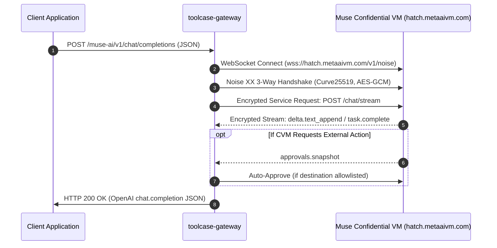

# Muse AI Conversational Chat

## 1. Overview

`toolcase-gateway` provides an OpenAI-compatible conversational chat interface powered by **Muse.ai Confidential VMs (CVM)**. Chat requests are encrypted using the Noise protocol, routed directly to isolated remote VMs, and streamed back as standard OpenAI chat completions.

Key capabilities:
- **Dedicated & Global Endpoints**: Dispatched directly via `POST /muse-ai/v1/chat/completions` or globally via `POST /v1/chat/completions` with `"model": "muse"`.
- **OpenAI Drop-In Compatibility**: Supports standard `messages` arrays, role attribution, and returns standard `chat.completion` objects.
- **Real-Time Web Search & Live Retrieval**: The Muse CVM LLM can execute real-time searches and tool calls to answer live queries (e.g., financial spot prices, current events, macroeconomic data).
- **Headless Sentinel Auto-Approval**: Network and browsing actions requested by the remote VM can be auto-approved using the gateway's Sentinel approval coordinator (`GW_MUSE_APPROVAL_MODE=on`).
- **End-to-End Cryptographic Isolation**: Client prompts are encrypted through a 3-way mutual `Noise_XX_25519_AESGCM_SHA256` handshake directly to the Confidential VM.
- **Thread Tracking & Lifecycle Retention**: Every conversation is assigned an isolated `thread_id` / `session_id` and automatically purged after a configurable retention period.
- **Multi-Turn Thread Continuation**: Continue follow-up questions in the exact same CVM thread by passing `reply_thread_id` (or `thread_id` / `session_id`), keeping conversational context and remote memory fully intact.
- **Mandatory Reply Thread Following for Data Queries**: When querying or getting data (live prices, macro indicators, market catalysts) that belongs to an ongoing or previous context, clients **MUST** follow the previous `reply_thread_id` to maintain continuous context and prevent CVM memory wiping.

---

## 2. API Endpoints

| Endpoint | Method | Purpose | Description |
| :--- | :--- | :--- | :--- |
| `/muse-ai/v1/chat/completions` | `POST` | Dedicated Chat Completions | Canonical endpoint dedicated to Muse AI chat. |
| `/muse-ai/chat/completions` | `POST` | Dedicated Route Alias | Convenience path without the `/v1` segment. |
| `/v1/chat/completions` | `POST` | Global Proxy Completions | OmniRoute proxy route (requires `"model": "muse"`). |
| `/muse-ai/v1/chat/completions` | `OPTIONS`| CORS Preflight | Returns `200 OK` with standard CORS headers. |
| `/muse-ai/v1/models` | `GET` | Model Catalog | Returns catalog entry for model `muse`. |
| `/muse-ai/v1/threads/:id` | `DELETE` | Thread Cleanup | Manually terminates and cleans up a remote thread. |

> [!NOTE]
> Non-POST HTTP methods on `/muse-ai/v1/chat/completions` (such as `GET`, `PUT`, or `DELETE`) fail closed with **`405 Method Not Allowed`**.

---

## 3. Quickstart Examples

### 3.1 Basic Chat Request (Dedicated Route)

```bash
curl -X POST http://127.0.0.1:20130/muse-ai/v1/chat/completions \
  -H "Content-Type: application/json" \
  -d '{
    "model": "muse",
    "messages": [
      {
        "role": "user",
        "content": "Hello! Explain what a Confidential VM is in 2 sentences."
      }
    ]
  }'
```

### 3.2 Live Search & Financial Analysis Query

The Muse CVM can look up live web sources and technical indicators to answer real-time questions:

```bash
curl -X POST http://127.0.0.1:20130/muse-ai/v1/chat/completions \
  -H "Content-Type: application/json" \
  -d '{
    "model": "muse",
    "messages": [
      {
        "role": "user",
        "content": "let'\''s search price of XAU/USD today and it will how to 2 hours next"
      }
    ]
  }'
```

### 3.2.1 Getting Subsequent Data (Required: Follow Reply Thread)

When fetching updated data, checking current prices, or querying fresh macro developments for a previously analyzed asset, the request **MUST** follow the previous thread by passing `reply_thread_id`:

```bash
curl -X POST http://127.0.0.1:20130/muse-ai/v1/chat/completions \
  -H "Content-Type: application/json" \
  -d '{
    "model": "muse",
    "reply_thread_id": "54515aa9-0d4e-44dd-bbb1-3bc61363509a",
    "messages": [
      {
        "role": "user",
        "content": "Get updated spot price of XAU/USD now and compare against the earlier benchmark."
      }
    ]
  }'
```

Following the reply thread ensures the CVM performs an incremental update rather than a full cold search, reducing latency and preserving conversational context.

### 3.3 Global OpenAI Proxy Route

If your client or SDK points to a generic OpenAI base URL (e.g. `http://127.0.0.1:20130/v1`):

```bash
curl -X POST http://127.0.0.1:20130/v1/chat/completions \
  -H "Content-Type: application/json" \
  -d '{
    "model": "muse",
    "messages": [
      {
        "role": "user",
        "content": "Provide a brief summary of quantum computing."
      }
    ]
  }'
```

### 3.4 Continuing an Existing Conversation (Multi-Turn Chat)

When you receive a response from Muse AI, take the `reply_thread_id` (or `thread_id`) returned in the response JSON and pass it in subsequent turns. The CVM preserves full conversational context across turns:

**Turn 1: Start Conversation**
```bash
curl -X POST http://127.0.0.1:20130/muse-ai/v1/chat/completions \
  -H "Content-Type: application/json" \
  -d '{
    "model": "muse",
    "messages": [
      {
        "role": "user",
        "content": "My favorite color is emerald green."
      }
    ]
  }'
```
*Response returns `"reply_thread_id": "54515aa9-0d4e-44dd-bbb1-3bc61363509a"`.*

**Turn 2: Follow-Up in the Same Thread**
```bash
curl -X POST http://127.0.0.1:20130/muse-ai/v1/chat/completions \
  -H "Content-Type: application/json" \
  -d '{
    "model": "muse",
    "reply_thread_id": "54515aa9-0d4e-44dd-bbb1-3bc61363509a",
    "messages": [
      {
        "role": "user",
        "content": "What is my favorite color?"
      }
    ]
  }'
```
*The assistant answers: "Your favorite color is emerald green!" because the thread was continued.*

---

## 4. Request & Response Schemas

### 4.1 Request Format

Requests conform to the standard OpenAI chat completions schema.

```json
{
  "model": "muse",
  "messages": [
    {
      "role": "system",
      "content": "You are a helpful financial analyst."
    },
    {
      "role": "user",
      "content": "What is the spot price of gold today?"
    }
  ]
}
```

#### Fields

| Field | Type | Required | Description |
| :--- | :--- | :--- | :--- |
| `model` | `string` | Optional* | Target model. Recommended value is `"muse"`. When calling `/muse-ai/v1/chat/completions`, defaults to `muse`. |
| `reply_thread_id` | `string` | **Required (for continuation)** | ID of an existing thread to continue. When a query belongs to a prior context, conversational turn, or ongoing monitoring topic, callers **MUST** provide `reply_thread_id` to preserve CVM context, avoid state wiping, and deduplicate transcripts. Aliases `thread_id` and `session_id` are also accepted. |
| `messages` | `array` | Optional* | Array of message objects containing `role` (`"user"`, `"assistant"`, `"system"`) and `content`. |
| `prompt` | `string` | Optional* | Alternative top-level string prompt if not using the `messages` array. |

*\*At least one of `messages` or `prompt` must be provided.*

> [!IMPORTANT]
> **Strict Context Continuation Requirement**:
> When querying or getting data from Muse chat that belongs to an ongoing task, sequential multi-turn chat, or repetitive market research context (e.g. tracking Gold or NVDA prices across multiple intervals), clients **MUST follow the reply thread** by passing the `reply_thread_id` returned in the preceding response.
>
> If a client omits `reply_thread_id` when fetching subsequent data:
> 1. **CVM Memory Wipe**: The gateway treats the request as a disconnected, isolated session, causing the remote CVM to provision a blank session with zero awareness of previous queries, established constraints, or previously verified benchmarks.
> 2. **Redundant Live Web Searches**: The CVM is forced to run duplicate web searches from scratch, increasing latency and burning approval tokens.
> 3. **Transcript Fragment Disconnect**: The gateway cannot link the latest query to prior exchanges, breaking historical context and multi-turn analytical reasoning.
> 4. **Retention Timer Stall**: The background lifecycle daemon will not know the thread is still active, risking automated cleanup of the earlier session.

### 4.2 Response Format

Completions return a standard OpenAI `chat.completion` object containing metadata, token counts, and session tracking identifiers:

```json
{
  "id": "chatcmpl-5b14f739-e4a2-4dcc-9ca6-7e2ab27c3bc1",
  "object": "chat.completion",
  "created": 1728000000,
  "model": "muse",
  "thread_id": "54515aa9-0d4e-44dd-bbb1-3bc61363509a",
  "session_id": "54515aa9-0d4e-44dd-bbb1-3bc61363509a",
  "reply_thread_id": "54515aa9-0d4e-44dd-bbb1-3bc61363509a",
  "choices": [
    {
      "index": 0,
      "message": {
        "role": "assistant",
        "content": "The spot price of gold (XAU/USD) today is trading around $4,062 - $4,089 per ounce..."
      },
      "finish_reason": "stop"
    }
  ],
  "usage": {
    "prompt_tokens": 12,
    "completion_tokens": 145,
    "total_tokens": 157
  }
}
```

#### Extension Fields
- `reply_thread_id`: Convenient thread identifier to pass in your next request body to continue this exact conversation.
- `thread_id`: Unique identifier for the conversation thread assigned by the Muse CVM.
- `session_id`: Unique session identifier used for stream subscription and approval scoping.

---

## 5. Continuing Conversations in Existing Threads

### 5.1 How Continuation Works
1. **Thread ID Extraction**: The gateway inspects the incoming JSON payload for `reply_thread_id` (or fallback keys `thread_id`, `session_id`, `reply_to_thread_id`, or `metadata.reply_thread_id`).
2. **Sanitization**: Optional prefixes like `thread_` or `session_` are automatically stripped, and the identifier is verified as a valid UUID. If malformed, the request fails closed immediately with `400 Bad Request`.
3. **Prompt Disambiguation**: When continuing an existing thread, the gateway extracts the latest user prompt from the `messages` array. This prevents duplicating previously stored chat history into the CVM's remote transcript.
4. **Session Subscription**: The CVM daemon resumes the session stream, produces context-aware continuation deltas, and preserves conversation memory.
5. **Retention Timer Refresh**: Upon every continued turn, the gateway automatically updates the thread's last-activity timestamp (`created_at = now`) in the thread registry, ensuring that active ongoing discussions are not reclaimed while still in use.

### 5.2 Mandatory Thread Following for Client Agents & Ingestion Pipelines

Automated agents, trading bots, and background polling loops that periodically query Muse AI for market intelligence or asset updates **MUST** retain and follow the active `reply_thread_id` per asset/topic:

```typescript
// Idiomatic Client Implementation (TypeScript)
class MuseClient {
  private activeThreads = new Map<string, string>(); // symbol/context -> reply_thread_id

  public async queryMarketIntel(symbol: string): Promise<MuseMarketIntel> {
    const key = symbol.toUpperCase();
    const threadToFollow = this.activeThreads.get(key);

    const response = await this.chat(`Provide updated live spot price and macro drivers for ${key}`, {
      // STRICT REQUIREMENT: Follow existing reply thread if previous context exists
      threadId: threadToFollow,
    });

    // Save newly returned or confirmed reply_thread_id for subsequent calls
    const nextThreadId = response.reply_thread_id || response.thread_id;
    if (nextThreadId) {
      this.activeThreads.set(key, nextThreadId);
    }

    return extractIntel(response);
  }
}
```

By following this pattern:
- The first call initializes the thread and triggers the initial web search.
- All subsequent calls for that asset submit only incremental follow-up prompts into the **exact same remote CVM thread**, preserving historical memory, saving latency, and maintaining complete conversational continuity.

---

## 6. Live Search & Real-Time Data

When asked queries requiring current real-world information (such as commodity prices, foreign exchange rates, or news events), the Muse Confidential VM can initiate search tools:

1. **Tool Invocation**: The CVM LLM recognizes that fresh data is required and triggers an internal search or browsing tool.
2. **Sentinel Security Check**: If the external lookup requires egress authorization, the remote daemon emits an `approvals.snapshot` event.
3. **Auto-Approval**: The gateway's Sentinel coordinator evaluates the domain and action type. If permitted by policy, the action is automatically approved and execution continues seamlessly.
4. **Data Aggregation**: The CVM ingests the live results and synthesizes a comprehensive response with current numbers and market context.

### 6.1 Data Retrieval Rule: Mandatory Reply Thread Continuation

> [!IMPORTANT]
> **Data Ingestion Protocol**:
> When getting updated data, re-checking live prices, or polling sequential market telemetry for an asset, clients **MUST follow the reply thread** by passing `reply_thread_id`.
>
> 1. **Turn 1 (Initial Data Ingestion)**: Request searches live spot data for an asset (e.g. Gold XAU/USD). The response returns current metrics along with a `reply_thread_id`.
> 2. **Turn 2+ (Subsequent Data Updates)**: Client **MUST** pass that `reply_thread_id`. The CVM recognizes the prior context, performs an efficient delta search, and compares the new spot level against the earlier checkpoint without repeating baseline setup steps.
> 3. **Failure Mode (Omitting Thread)**: Submitting repeated queries without `reply_thread_id` creates isolated orphan threads, wipes memory of previous price levels, triggers duplicate Sentinel auto-approvals, and violates context continuity.

---

## 7. Sentinel Auto-Approval Configuration

When the remote CVM performs actions that require permission, it issues a structured approval snapshot. By default, the gateway operates in `scoped_auto` mode (or `GW_MUSE_APPROVAL_MODE=on`), allowing approved domains to execute without blocking the user:

### Environment Variables

```ini
# Approval mode: on (scoped_auto), observe, or off
GW_MUSE_APPROVAL_MODE=on

# Comma-separated list of permitted network destinations
GW_MUSE_APPROVAL_ALLOWED_DESTINATIONS=muse.ai,api.muse.ai

# Permitted action types
GW_MUSE_APPROVAL_ALLOWED_TYPES=network

# Automatically prefer single-use permission grants
GW_MUSE_APPROVAL_PREFER_ALLOW_ONCE=true

# Maximum auto-approvals permitted per chat session
GW_MUSE_APPROVAL_MAX_DECISIONS=5
```

### Approval Statuses
- **Approved**: Action destination matches `allowed_destinations` and type matches `allowed_types`. Gateway issues an instant approval token.
- **Conflict (`409 Conflict`)**: Action requires human review (e.g. connector integration or untrusted domain). The gateway rejects the completion request with HTTP 409, prompting the user to grant permission in the browser.

---

## 8. Cryptographic Transport Architecture

Conversational requests are handled entirely in memory with strict cryptographic guarantees:



1. **VM Wake & Notary Token**: If not statically supplied, the gateway fetches notary and access tokens from `POST /api/hatch/token`.
2. **Noise XX Mutual Handshake**: Ephemeral Curve25519 keypairs are generated per connection; payloads are encrypted with `AES-25519-GCM` with SHA-256 hashing.
3. **Stream Subscription**: The client subscribes to Stream 2 (`/chat/subscribe`) to receive streaming text chunks (`delta.text_append`).
4. **Assembly**: Slices are parsed by `MuseChatStream` and formatted into a unified `chat.completion` response.

---

## 9. Thread Lifecycle & Cleanup

Every conversation thread generates a remote thread resource inside the CVM. To prevent unmanaged resource accumulation, `toolcase-gateway` provides an automated background thread lifecycle daemon:

```ini
# Enable automatic cleanup of chat threads
GW_MUSEAI_AUTO_CLEANUP_THREADS=true

# Retention period before thread deletion (seconds)
# Common profiles:
#   7200   = 2 hours (ideal for active session pools)
#   172800 = 2 days (default)
#   0      = Immediate ephemeral deletion upon response completion
GW_MUSEAI_THREAD_RETENTION_SECS=7200
```

- **Retention Lifecycle**: When retention is greater than 0, threads are tracked in the gateway's thread registry and persisted to `.gw_state/threads/`.
- **Activity Refresh**: Whenever a client continues chatting in an existing thread via `reply_thread_id`, the gateway resets that thread's activity timestamp (`created_at = now`), guaranteeing that actively chatted threads will not expire mid-conversation.
- **Daemon Interval**: The background maintenance daemon executes every 300 seconds, scanning local and remote CVM sessions (`sessions.list`) and issuing `/api/session/delete` for any thread older than the retention threshold.
- **Ephemeral Mode**: When `GW_MUSEAI_THREAD_RETENTION_SECS=0`, threads are deleted immediately after the assistant finishes responding.
- **Manual Cleanup**: Manual deletion is available at any time via `DELETE /muse-ai/v1/threads/:id` or triggered via `POST /muse-ai/v1/threads/cleanup`.

---

## 10. Error Reference & Troubleshooting

| HTTP Status | Error Type | Cause | Resolution |
| :--- | :--- | :--- | :--- |
| `400 Bad Request` | `Invalid JSON` or empty prompt | Request payload was not valid JSON, or both `messages` and `prompt` were missing. | Verify that request body contains valid JSON with a `messages` array or `prompt` string. |
| `400 Bad Request` | `Invalid thread_id / reply_thread_id` | Value provided for `reply_thread_id` or `thread_id` is not a valid UUID format. | Ensure the thread ID matches the UUID returned in the previous completion response. |
| `401 Unauthorized` | `PermissionDenied` | Muse authentication cookie or access token is missing, expired, or invalid. | Update `GW_MUSEAI_COOKIE` or upload a fresh HAR capture via `/muse-config`. |
| `405 Method Not Allowed` | `Method Not Allowed` | Calling `/muse-ai/v1/chat/completions` with `GET`, `PUT`, or `DELETE`. | Use `POST` for chat completions. |
| `409 Conflict` | `MuseApprovalRequired` | The CVM requested an action (e.g. connector access) that is not in the Sentinel auto-approval allowlist. | Open the Muse web UI in your browser to approve the pending action, or add the destination to `GW_MUSE_APPROVAL_ALLOWED_DESTINATIONS`. |
| `502 Bad Gateway` | `Bad Gateway` | Remote CVM WebSocket reset, network handshake failed, or upstream server error. | Verify internet connectivity to `metaaivm.com` and ensure VM is in `RUNNING` state. |
| `504 Gateway Timeout` | `Gateway Timeout` | Remote CVM did not return completion tokens within the operation deadline (default: 360s). | Check remote service status and network latency. |
