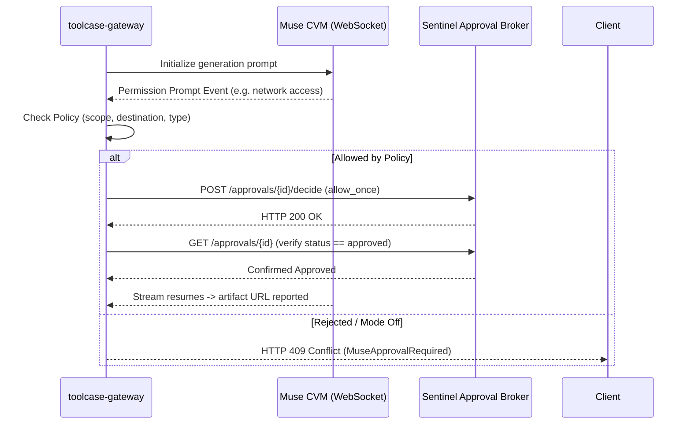

# Muse Video Generation

## 1. Overview

`toolcase-gateway` provides end-to-end video synthesis capabilities powered by Muse.ai Confidential VMs (CVM) and Noise protocol WebSockets at `/muse-ai/v1/create-video`.

Key features:
- **Durable Job Tracking**: Video jobs are recorded under `.gw_state/video_jobs/{job_id}.json` with status lifecycle and revision tracking.
- **Headless Sentinel Auto-Approval**: Evaluates permission requests automatically when configured with `GW_MUSE_APPROVAL_MODE=on` (or `scoped_auto`), preventing blocking on browser interaction.
- **Default Video Prompt Configuration**: Operators can define or update the default fallback generation prompt via the web dashboard at `/gateway-config/dashboard` or via `MUSE_LIVE_VIDEO_PROMPT`.
- **Idempotency Safeguards**: Repeated requests using the same `idempotency_key` or `submission_key` return existing job status without incurring duplicate generation costs.

---

## 2. API Endpoints

### 2.1 Create Video (`POST /muse-ai/v1/create-video`)

Submits a new text-to-video generation task. Supports both **synchronous** (blocking until completion) and **asynchronous** (non-blocking submission and polling) execution modes.

#### Execution Modes
- **Synchronous Mode (Wait for Completion)**:
  - Activated by query parameter `?wait=true` or `?sync=true`, request body field `"wait": true`, or header `Prefer: respond-async=false`.
  - Default for command-line clients such as `curl`.
  - Holds the HTTP connection open until the Confidential VM finishes video synthesis and the gateway downloads and validates the internal media over Noise.
  - Directly returns `status: "completed"`, `video_url`, and `full_video_url`.
- **Asynchronous Mode (Background Submission)**:
  - Activated by query parameter `?async=true`, request body field `"async": true`, or browser callers without sync flags.
  - Immediately returns `status: "submitting"` and an allocated job ID.
  - The client polls `GET /muse-ai/v1/videos/{id}` until finished.

#### Synchronous Request Example
```bash
curl -X POST "http://127.0.0.1:20130/muse-ai/v1/create-video?wait=true" \
  -H "Content-Type: application/json" \
  -d '{
    "prompt": "A small orange fox wearing a blue scarf rides a skateboard through a colorful city park, bouncy animation, bright morning light.",
    "model": "muse-video",
    "aspect_ratio": "16:9",
    "duration": 5
  }'
```

#### Synchronous Response (`200 OK`)
```json
{
  "id": "video-123e4567-e89b-12d3-a456-426614174000",
  "object": "video.generation",
  "created": 1728000000,
  "provider": "muse_chat",
  "resolved_provider": "muse_chat",
  "requested_model": "muse-video",
  "resolved_model": "muse-video",
  "model": "muse-video",
  "prompt": "A small orange fox wearing a blue scarf rides a skateboard through a colorful city park...",
  "requested_aspect_ratio": "16:9",
  "requested_duration": 5,
  "status": "completed",
  "provider_status": "artifact_url_reported",
  "output_verified": true,
  "media_validated": true,
  "video_url": "/muse-ai/v1/videos/video-123e4567-e89b-12d3-a456-426614174000/content",
  "full_video_url": "http://127.0.0.1:20130/muse-ai/v1/videos/video-123e4567-e89b-12d3-a456-426614174000/content"
}
```

#### Asynchronous Response (`200 OK`)
When called asynchronously, the endpoint returns immediately with:
```json
{
  "id": "video-123e4567-e89b-12d3-a456-426614174000",
  "object": "video.generation",
  "created": 1728000000,
  "status": "submitting",
  "video_url": "",
  "full_video_url": ""
}
```

---

### 2.2 Get Video Job Status (`GET /muse-ai/v1/videos/{id}`)

Retrieves status, artifacts, and approval details for a specific video job.

#### Request
```http
GET /muse-ai/v1/videos/video-123e4567-e89b-12d3-a456-426614174000
Host: 127.0.0.1:20130
```

#### Response (`200 OK`)
```json
{
  "id": "video-123e4567-e89b-12d3-a456-426614174000",
  "object": "video.generation",
  "created": 1728000000,
  "provider": "muse_chat",
  "status": "completed",
  "approval_status": null,
  "approval_id": null,
  "output_verified": true,
  "media_validated": true,
  "video_url": "/muse-ai/v1/videos/video-123e4567-e89b-12d3-a456-426614174000/content",
  "full_video_url": "http://127.0.0.1:20130/muse-ai/v1/videos/video-123e4567-e89b-12d3-a456-426614174000/content",
  "prompt": "A small orange fox wearing a blue scarf rides a skateboard...",
  "model": "muse-video",
  "requested_model": "muse-video",
  "aspect_ratio": "16:9",
  "duration": 5,
  "thread_id": "thread-123e4567",
  "revisions": [],
  "last_activity_at": 1728000000
}
```

---

### 2.3 Video Media Content & Streaming (`GET /muse-ai/v1/videos/{id}/content`)

Streams genuine ISO MP4 bytes for verified and downloaded video artifacts directly from the gateway.

#### Features:
- **Range Header Support**: Responds with `206 Partial Content` and `Content-Range: bytes start-end/total` for browser video seeking and scrub bars.
- **HEAD Method Support**: Allows clients and media players to inspect `Content-Length`, `Content-Type: video/mp4`, and `Accept-Ranges: bytes` without transferring body bytes.
- **CORS Headers**: Sends `Access-Control-Allow-Origin: *` for direct embedding into web applications.
- **Download Alias**: Supports `GET /muse-ai/v1/videos/{id}/download` as a drop-in alias.

#### Request Example
```bash
curl -I http://127.0.0.1:20130/muse-ai/v1/videos/video-123e4567-e89b-12d3-a456-426614174000/content
```

#### Response (`200 OK`)
```http
HTTP/1.1 200 OK
Content-Type: video/mp4
Content-Length: 5925734
Accept-Ranges: bytes
Access-Control-Allow-Origin: *
Access-Control-Allow-Headers: Range, Content-Type, Accept
Access-Control-Expose-Headers: Content-Range, Content-Length, Accept-Ranges
Content-Disposition: inline; filename="video-123e4567-e89b-12d3-a456-426614174000.mp4"
Connection: close
```

---

### 2.4 Update Video Prompt (`PUT /muse-ai/v1/videos/{id}`)

Updates the prompt of an existing video job and records a revision.

#### Request
```json
PUT /muse-ai/v1/videos/video-123e4567-e89b-12d3-a456-426614174000
Content-Type: application/json

{
  "prompt": "Updated prompt: enhance cinematic golden-hour lighting and dynamic camera angles."
}
```

#### Response (`200 OK`)
```json
{
  "id": "video-123e4567-e89b-12d3-a456-426614174000",
  "object": "video.generation",
  "updated_at": 1728000500,
  "prompt": "Updated prompt: enhance cinematic golden-hour lighting and dynamic camera angles.",
  "status": "updated"
}
```

---

### 2.5 Delete Thread (`DELETE /muse-ai/v1/threads/{id}`)

Cleans up an active thread on the Muse upstream server.

#### Request
```http
DELETE /muse-ai/v1/threads/thread-123e4567
```

#### Response (`200 OK`)
```json
{
  "ok": true,
  "thread_id": "thread-123e4567",
  "status": "deleted"
}
```

---

### 2.6 Run Thread Cleanup Cycle (`POST /muse-ai/v1/threads/cleanup`)

Triggers an on-demand cleanup sweep to purge all threads that have exceeded their retention period (`GW_MUSEAI_THREAD_RETENTION_SECS`).

#### Request
```http
POST /muse-ai/v1/threads/cleanup
```

#### Response (`200 OK`)
```json
{
  "ok": true,
  "deleted": 5,
  "retained": 2
}
```

---

## 3. Headless Sentinel Auto-Approval & Idempotency

When enabled, the Rust-native Sentinel coordinator listens to approval events emitted during generation and resolves eligible, pre-authorized scoped approvals (e.g. `network`) automatically:



### Configuration Parameters
- `GW_MUSE_APPROVAL_MODE`: `off` (default), `observe`, or `scoped_auto` / `on`.
- `GW_MUSE_APPROVAL_ALLOWED_DESTINATIONS`: Required comma-separated allowlist of destination hostnames (e.g. `muse.ai,googleapis.com`).
- `GW_MUSE_APPROVAL_ALLOWED_TYPES`: Comma-separated list of approved types (default: `network`). Connector approvals always require manual authorization.
- `GW_MUSE_APPROVAL_PREFER_ALLOW_ONCE`: `true` (default) or `false`.
- `GW_MUSE_APPROVAL_ALLOW_ALWAYS`: `false` (default) or `true`.
- `GW_MUSE_APPROVAL_MAX_DECISIONS`: Maximum decisions allowed per job (default: `3`).
- `GW_MUSE_APPROVAL_TIMEOUT_SECS`: Sentinel RPC timeout in seconds (default: `30`).

### Dynamic Policy Management via Dashboard
You can view and modify approval parameters in real time at `/gateway-config/dashboard` or via:
```bash
curl -X POST http://127.0.0.1:20129/api/v1/dashboard/muse-config \
  -H "Content-Type: application/json" \
  -d '{
    "approval_mode": "on",
    "allowed_destinations": ["muse.ai"],
    "allowed_types": ["network"],
    "default_video_prompt": "A majestic eagle soaring over snow-capped mountains"
  }'
```

### Dynamic Rollback
To immediately disable auto-approval without restarting the process:
1. Submit `POST /api/v1/dashboard/muse-config` with `{"approval_mode": "off"}`.
2. All pending approvals will immediately fail-closed and return HTTP 409 Conflict. Previous job history is preserved.

---

## 4. Supported Models & Aspect Ratios

### Supported Model Identifiers
- Canonical: `muse-video`
- Supported Aliases: `muse`, `gen-3`, `gen-2`, `kling`, `gen-4`, `gen-4.5`, `gen-4-turbo`, `aleph-2.0`, `ruby`

### Supported Aspect Ratios
- `16:9` (Default)
- `9:16`
- `1:1`
- `5:4`
- `4:3`

---

## 5. Error Handling

| Status Code | Error Code | Description |
| :--- | :--- | :--- |
| `400 Bad Request` | `INVALID_INPUT` | Missing prompt, empty string, or unsupported model/ratio. |
| `401 Unauthorized` | `AUTHENTICATION_REQUIRED` | Missing or invalid Muse credentials (`cookie`, `access_token`). |
| `409 Conflict` | `MuseApprovalRequired` | Pending approval required; auto-approval is off or destination is not allowlisted. |
| `501 Not Implemented` | `ARTIFACT_MISSING` | Generation finished without yielding a valid HTTPS video URL. |
| `502 Bad Gateway` | `UPSTREAM_TRANSPORT_ERROR` | Upstream WebSocket connection or Noise handshake failed. |
